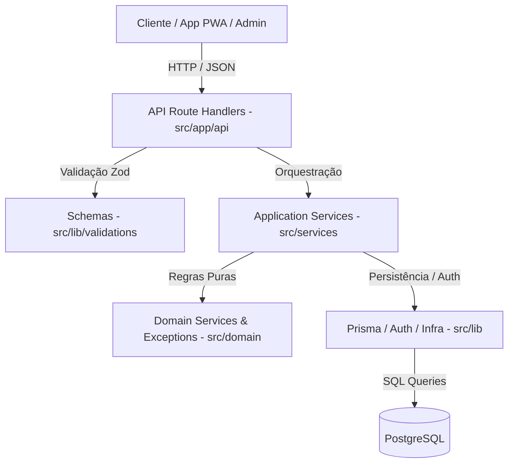

# Skill Obrigatória de Engenharia de Software (SOLID, Clean Code & Testes)

Esta Skill estabelece os **padrões técnicos inegociáveis** de qualidade, arquitetura, testes automatizados, segurança defensiva e manutenibilidade para o desenvolvimento no projeto **PopClub**.

> [!IMPORTANT]
> **APLICAÇÃO OBRIGATÓRIA E PERMANENTE**: Esta skill NÃO é opcional nem deve ser acionada apenas quando solicitada explicitamente. Ela deve reger **todo e qualquer código** criado, modificado, refatorado ou corrigido.

---

## 1. Princípios Fundamentais (SOLID Proporcional)

Consulte o guia completo em [solid-principles.md](./references/solid-principles.md).

### S — Responsabilidade Única (Single Responsibility Principle - SRP)
- Cada módulo, classe, função ou componente deve possuir **um único motivo para mudar**.
- **Regra de Ouro**: É expressamente proibido misturar manipulação HTTP (Request/Response), validação de entrada, orquestração de negócio, persistência no banco (Prisma) e formatação de saída no mesmo arquivo ou função.
- **Divisão Prática no PopClub**:
  - `src/app/api/.../route.ts`: Apenas validação de schema de entrada, extração de autenticação/sessão, chamada ao serviço/domínio e retorno de status HTTP usando `handleApiError`.
  - `src/services/...`: Orquestração de casos de uso (aplicação), integração com APIs externas ou serviços de infraestrutura.
  - `src/domain/...`: Entidades, cálculos puros de domínio (carrinho, estoque, cupons, horários), regras de negócio e exceções customizadas.
  - `src/lib/...`: Clientes de infraestrutura (`prisma.ts`, `auth.ts`, `rateLimit.ts`, `logger.ts`).

### Demais Princípios SOLID
- **O (Open/Closed)**: Aberto para extensão, fechado para modificação. Use polimorfismo ou estratégias (Strategy Pattern) para comportamentos variantes em vez de blocos gigantescos de `switch`/`if-else`.
- **L (Liskov Substitution)**: Classes e interfaces derivadas devem cumprir o contrato de suas abstrações sem quebrar premissas ou lançar exceções inesperadas.
- **I (Interface Segregation)**: Não crie interfaces gigantescas que forçam consumidores a depender de métodos desnecessários. Prefira interfaces pequenas e focadas.
- **D (Dependency Inversion)**: Módulos de alto nível não devem depender de implementações rígidas de baixo nível. Injete dependências ou desacople via funções puras e contratos quando houver necessidade real.

> [!TIP]
> **Proporcionalidade**: Evite "over-engineering". Não crie 5 camadas de abstração para uma operação atômica de consulta. O princípio serve para desacoplar complexidade, não para gerar burocracia inútil.

---

## 2. Padrões de Clean Code

Consulte o guia detalhado em [clean-code-standards.md](./references/clean-code-standards.md).

1. **Nomenclatura Significativa**:
   - Nomes reveladores de intenção (`isStoreOpenNow`, `calculateCartSubtotal`, `validateStockAvailability`).
   - Evite abreviações crípticas (`calc`, `usr`, `ordTmp`) e variáveis genéricas (`data`, `item`, `obj`, `res2`).
2. **Funções Pequenas e Coesas**:
   - Cada função deve fazer uma única coisa e fazê-la bem.
   - Idealmente menos de 25-30 linhas por função.
3. **Sem Valores Mágicos**:
   - Substitua números e strings mágicas por constantes semânticas (`MIN_ORDER_AMOUNT_CENTS = 1500`, `SESSION_COOKIE_MAX_AGE_SECONDS = 86400 * 7`).
4. **Tratamento Explícito de Erros**:
   - Lance exceções de domínio tipadas (`OutOfStockException`, `ResourceNotFoundException`, `UnauthorizedException`) derivadas de `DomainException`.
   - Utilize `handleApiError(error, context)` para respostas HTTP uniformes.
   - Nunca silencie erros em blocos `catch` vazios.
5. **Comentários Explanatórios**:
   - O código deve ser autoexplicativo quanto ao *o que* faz. Comentários devem explicar o *porquê* (decisões de negócio, compensações de performance, compatibilidade legada).
6. **Eliminação de Código Morto**:
   - Remova imports não utilizados, variáveis não lidas e código comentado.

---

## 3. Testes Automatizados Obrigatórios (Vitest)

Consulte o guia de testes em [testing-strategy.md](./references/testing-strategy.md).

> [!IMPORTANT]
> **Nenhuma funcionalidade ou correção de bug é considerada concluída sem testes automatizados que comprovem seu funcionamento.**

### Tipos de Testes e Convenções
- **Framework**: `Vitest` (`npm test`, `npm run test:coverage`).
- **Testes Unitários (`tests/unit/*.test.ts`)**:
  - Testam regras puras de negócio, cálculos financeiros, horários de esteira, cupons, validações de estoque.
  - Execução rápida, sem dependência de banco de dados ou rede.
- **Testes de Integração e API (`tests/integration/*.test.ts`)**:
  - Testam rotas de API (`/api/...`), controle de acesso RBAC, tratamento uniforme de erros (`handleApiError`), conformidade LGPD, rate limiting e segurança de autenticação.
  - Validam contratos HTTP, cabeçalhos, status codes (200, 201, 400, 401, 403, 404, 500) e integridade de resposta JSON.
- **Testes de Regressão (Bug Fixes)**:
  - Todo bug corrigido DEVE ter um teste automatizado que reproduza o cenário da falha e garanta que o bug não volte a ocorrer.

### Regras Estritas para Testes:
1. Nunca altere um teste existente apenas para "fazer passar" quando a lógica da aplicação estiver com comportamento incorreto.
2. Nunca remova ou comente testes existentes para mascarar quebras.
3. Não declare que os testes passaram sem executá-los no terminal e inspecionar a saída (`npm test`).
4. Mantenha os testes determinísticos e isolados (evite dependência de ordem de execução ou horário global não congelado).

---

## 4. Arquitetura e Limites de Camadas

Consulte a estrutura de arquitetura em [architecture-layers.md](./references/architecture-layers.md).

- **Camada de Apresentação/Rotas (`src/app/api`)**: Recebe a requisição, valida com Zod, autoriza via RBAC/JWT, delega para serviços/domínio e responde. Sem SQL nem lógica matemática de negócio.
- **Camada de Aplicação (`src/services`)**: Coordena fluxos, transações de banco de dados e eventos secundários.
- **Camada de Domínio (`src/domain`)**: Lógica pura de negócio, independente de frameworks, banco de dados ou HTTP.
- **Camada de Infraestrutura (`src/lib`)**: Prisma client, helpers de segurança, rate limit, logging e clientes externos.

---

## 5. Segurança Defensiva e Integridade de Dados

Consulte o guia de segurança em [security-and-data.md](./references/security-and-data.md).

1. **Validação Rigorosa de Entrada**: Toda entrada de rota (body, query params, headers sensíveis) deve ser validada e parseada via Zod.
2. **Defesa em Profundidade (RBAC)**: Validar permissões e tokens em todas as rotas administrativas.
3. **Proteção Contra Vazamento de Dados**:
   - Mensagens de erro em produção NUNCA devem expor stack traces, strings de conexão, credenciais ou dados internos.
   - Usar `handleApiError` para sanitizar erros 500 para mensagens genéricas e logar os detalhes internamente.
4. **Transacionalidade**: Operações que afetam múltiplas tabelas (ex.: pedido + itens + atualização de estoque + baixa de cupom) DEVEM usar `prisma.$transaction()`.
5. **Sem Segredos em Código**: Segredos, chaves JWT e URLs de conexão pertencem a variáveis de ambiente (`.env`).

---

## 6. Fluxo de Trabalho e Checklist Obrigatório

Consulte o checklist interativo em [checklist.md](./references/checklist.md).

Antes de considerar qualquer tarefa finalizada, responda internamente ao checklist:

1. [ ] A mudança respeita o **SRP** e não misturou responsabilidades na mesma função/arquivo?
2. [ ] O código segue **Clean Code** (nomes claros, sem valores mágicos, métodos coesos)?
3. [ ] Cada componente reside na **camada arquitetural correta**?
4. [ ] Foram evitadas abstrações prematuras ou complexidade desnecessária?
5. [ ] Existem **testes automatizados** cobrindo os cenários de sucesso, falha e limites?
6. [ ] Se foi correção de bug, foi criado um **teste de regressão** reproduzindo a falha?
7. [ ] Os testes existentes continuam passando sem regressão (`npm test`)?
8. [ ] A validação de tipos e compilação passou com sucesso (`npm run build`)?
9. [ ] A análise estática de linter foi verificada (`npm run lint`)?
10. [ ] Os dados de entrada são sanitizados/validados e transações são seguras?
11. [ ] Não há risco de quebra de contratos existentes ou vazamento de dados sensíveis?
12. [ ] O script de verificação de qualidade (`./.agents/skills/mandatory-clean-code-solid/scripts/verify-quality.sh`) foi executado com sucesso?
