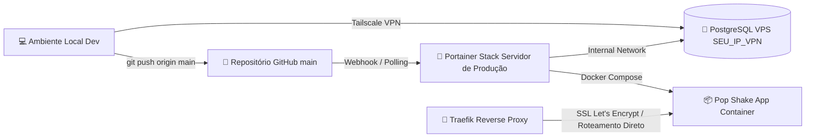

# Diretrizes Operacionais e Governança GitOps

**PopClub — Plataforma de Delivery PWA e Gestão Operacional**

Este documento estabelece o protocolo oficial de governança, arquitetura e entrega contínua (CI/CD) adotado na infraestrutura **Servidor de Produção**.

---

## 🏛️ Pilares da Arquitetura



---

## 📜 Regras Mandatórias de Operação

### 1. Single Source of Truth (Fonte Única da Verdade)
- O repositório Git oficial na branch **`main`** é a única fonte de verdade de todo o código, configurações e definições de banco de dados.
- **Proibição Estrita de Acesso Manual:** Nenhuma modificação de código, arquivos estáticos, variáveis de ambiente ou schema deve ser realizada diretamente via SSH, terminal interativo de containers (`docker exec`) ou painel não rastreado.
- Toda alteração de infraestrutura deve ser registrada declarativamente no arquivo `docker-compose.yml`.

### 2. Paridade Absoluta de Ambiente
- O ambiente de desenvolvimento local conecta-se diretamente ao banco de dados PostgreSQL hospedado no servidor de produção por meio da rede segura **Tailscale** (`SEU_IP_VPN:5432`).
- Isso garante que consultas, triggers, dados e permissões sejam 100% idênticos entre o desenvolvimento e a produção, eliminando divergências de dados fictícios ou migrações desalinhadas.

### 3. Protocolo de Validação Pré-Push (CI Local Obrigatório)
Antes de qualquer envio para o repositório remoto, o desenvolvedor ou agente deve executar impreterivelmente:
1. **Validação de Schema (se aplicável):**
   ```bash
   npx prisma generate
   ```
2. **Suíte de Testes Integrados (Smoke Tests):**
   ```bash
   node scripts/smoke-test-all.mjs
   ```
3. **Compilação e Verificação de Tipos:**
   ```bash
   npm run build
   ```
   *O comando deve finalizar obrigatoriamente com Exit Code 0 (Zero Erros).*

### 4. Implantação Declarativa (GitOps via Portainer)
- Todo deploy é automático e idempotente.
- Assim que o commit é aceito na branch `main`:
  1. O Portainer na **Servidor de Produção** detecta a atualização da stack.
  2. A nova imagem Docker é construída em multi-stage (`node:20-bookworm-slim` em modo standalone).
  3. O script `entrypoint.sh` aguarda a prontidão do banco e aplica as migrations pendentes (`prisma migrate deploy`).
  4. O Traefik aplica os roteadores SSL automáticos (`leresolver`) com roteamento direto para a aplicação.

---

## 🗂️ Estrutura de Scripts Operacionais

Consulte [scripts/README.md](scripts/README.md) para detalhes de execução dos testes e utilitários:
- **`scripts/smoke-test-all.mjs`**: Teste de ponta a ponta de autenticação, vitrine, pedidos e cupons.
- **`scripts/diagnose-db.mjs`**: Diagnóstico de latência e contagem de integridade de tabelas.
- **`scripts/utils/reset-admin.mjs`**: Utilitário de segurança para redefinição de credenciais do Administrador.
- **`scripts/utils/transfer-db.mjs`**: Utilitário de extração e migração de dados relacionais via Prisma.
