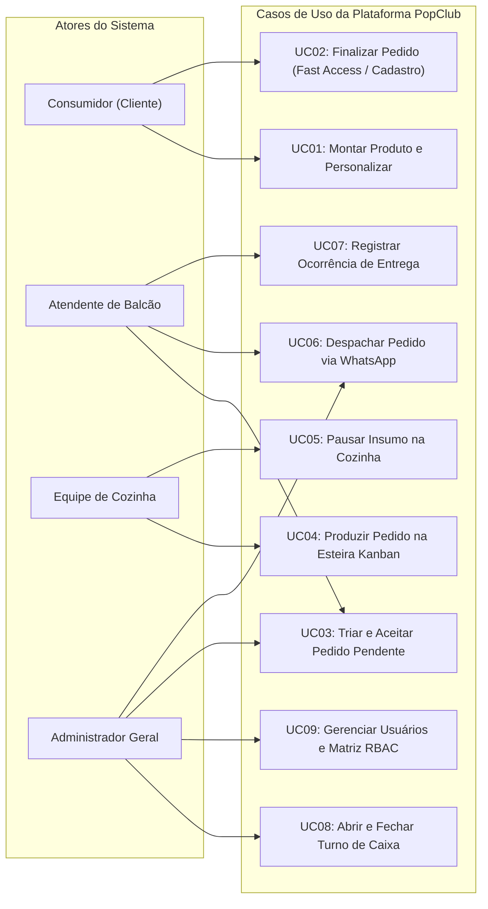
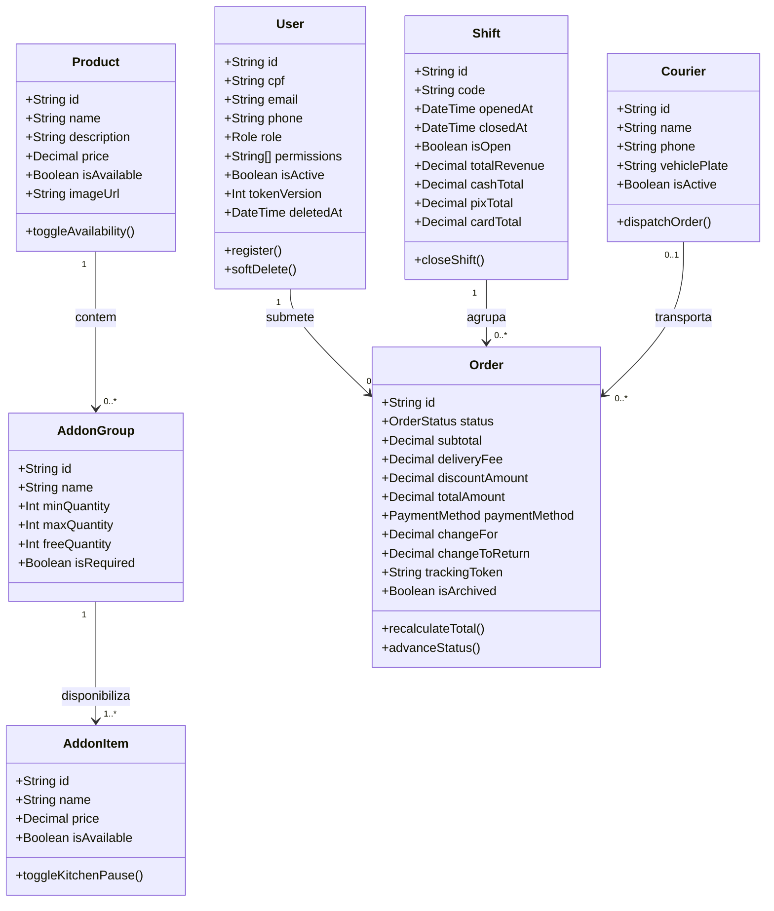
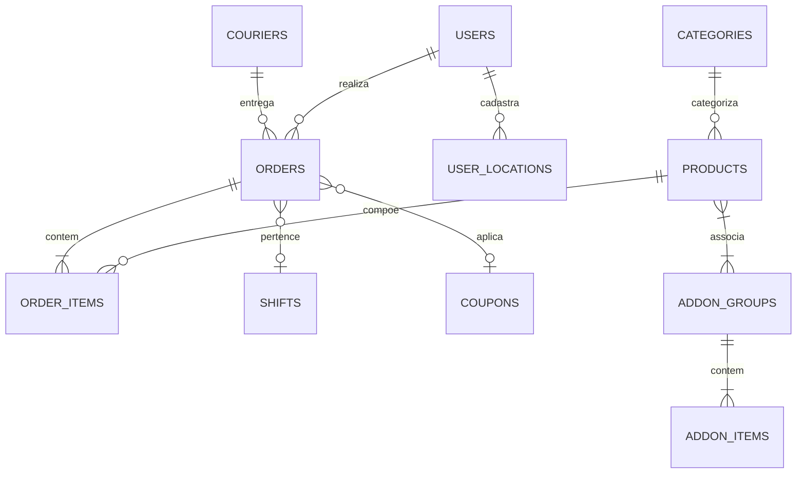

# CENTRO UNIVERSITÁRIO DE VÁRZEA GRANDE — UNIVAG
## CURSO DE TECNOLOGIA EM ANÁLISE E DESENVOLVIMENTO DE SISTEMAS
### PROJETO EXTENSIONISTA INTEGRADOR (2026/2)
### DESENVOLVIMENTO DE PROGRESSIVE WEB APPS (PWAs) COM FRAMEWORKS AVANÇADOS

---

# POPCLUB: PLATAFORMA DE DELIVERY PWA E GESTÃO OPERACIONAL
## Engenharia de Requisitos, Arquitetura de Software e Análise de Impacto de Negócio
### Projeto Final Integrador — Instruções Canônicas D.5 (Resolução 35/2017 - UNIVAG)

---

## 1. ELEMENTOS PRÉ-TEXTUAIS (NORMATIZADOS)

### 1.1. Capa e Folha de Rosto

**Instituição:** CENTRO UNIVERSITÁRIO DE VÁRZEA GRANDE (UNIVAG)  
**Curso:** TECNOLOGIA EM ANÁLISE E DESENVOLVIMENTO DE SISTEMAS  
**Disciplina:** Projeto Extensionista Integrador — Desenvolvimento de Progressive Web Apps (PWAs) com Frameworks Avançados (2026/2)  
**Título:** POPCLUB: PLATAFORMA DE DELIVERY PWA E GESTÃO OPERACIONAL  
**Subtítulo:** Engenharia de Requisitos, Arquitetura de Software e Análise de Impacto de Negócio  

**Equipe de Desenvolvimento (Equipe ADP):**
- **Wilton Gabriel Albuquerque Pereira** — Arquiteto de Software & Mantenedor Principal
- **Adriel Felipe** — Analista de Documentação
- **João Lucas** — Analista de Qualidade & Relacionamento

**Orientação Acadêmica:** Coordenação do Curso de Análise e Desenvolvimento de Sistemas  
**Entidade Parceira / Cliente Beneficiário:** Pop Shake Sorveteria & Açaí Artesanal  
**Área de Aplicação:** Gastronomia Comercial, Logística Urbana de Delivery e Engenharia de Software  
**Central de Anexos Oficiais (Google Drive):** [Pasta Compartilhada de Relatórios e Atas Extensionistas](https://drive.google.com/drive/folders/1iw4oxwSWsKvCcCP9YZipzOM0B2B7JmdR?usp=sharing)  
**Local e Ano:** Várzea Grande – MT, 2026  

---

### 1.2. Resumo e Palavras-chave

O presente projeto tem por finalidade projetar, especificar, desenvolver e validar a plataforma **PopClub**, um ecossistema computacional integrado voltado ao atendimento do comércio gastronômico varejista, implantado na empresa parceira **Pop Shake Sorveteria & Açaí Artesanal**, em Várzea Grande – MT. O negócio enfrentava forte compressão de rentabilidade gerada por taxas abusivas de 12% a 27% sobre o faturamento cobradas por marketplaces oligopolistas de delivery, desapropriação da carteira de clientes, falta de esteira operacional para alimentos com janela térmica ultracurta (açaí batido perdendo consistência em 4 minutos no calor regional) e descontrole financeiro no fechamento de múltiplos meios de pagamento. A solução desenvolvida adota a tecnologia Progressive Web App (PWA) construída com Next.js 16 em modo Standalone, TypeScript, Prisma ORM 6 e banco de dados PostgreSQL 16 Alpine, complementada por geolocalização soberana com OpenStreetMap/Leaflet e infraestrutura isolada via Docker e VPN Tailscale. A plataforma oferece compra sem atrito com *Fast Access*, esteira Kanban com alertas sonoros de cozinha, despacho ágil via WhatsApp e gestão financeira por turnos com bloqueio terminante de pedidos ativos. Como resultado, o tempo de montagem de pedidos caiu para 52 segundos, os erros de montagem foram mitigados e a empresa parceira obteve soberania sobre sua base de clientes com take-rate de 0%.

**Palavras-chave:** Progressive Web Apps; Delivery Próprio; Engenharia de Requisitos; Next.js; Gestão Operacional.

---

### 1.3. Sumário

1. **[1. ELEMENTOS PRÉ-TEXTUAIS (NORMATIZADOS)](#1-elementos-pré-textuais-normatizados)**
   - 1.1. Capa e Folha de Rosto
   - 1.2. Resumo e Palavras-chave
   - 1.3. Sumário
2. **[2. INTRODUÇÃO](#2-introdução)**
   - 2.1. Propósito do Documento
   - 2.2. Escopo do Produto
   - 2.3. Premissas do Projeto
   - 2.4. Convenções, Termos e Abreviações
   - 2.5. Estrutura do Documento
3. **[3. FUNDAMENTAÇÃO TEÓRICA](#3-fundamentação-teórica)**
   - 3.1. Progressive Web Applications (PWAs) no Varejo de Alimentos
   - 3.2. Frameworks e Tecnologias Modernas de Software
   - 3.3. Persistência Relacional, ORM e Transações ACID
   - 3.4. Topologia de Infraestrutura, Segurança e VPN Mesh
4. **[4. VISÃO GERAL](#4-visão-geral)**
   - 4.1. Descrição do Produto
   - 4.2. Usuários da Solução (Perfis e Atores)
   - 4.3. Abrangência e Soluções Similares (Benchmark)
   - 4.4. Suposições e Dependências do Sistema
5. **[5. REQUISITOS DO PRODUTO](#5-requisitos-do-produto)**
   - 5.1. Requisitos Funcionais (RF01 a RF32)
   - 5.2. Requisitos Não-Funcionais Gerais (RNF01 a RNF16)
   - 5.3. Matriz de Rastreabilidade Bidirecional de Requisitos
6. **[6. DOCUMENTAÇÃO DAS FUNCIONALIDADES (UML E BANCO DE DADOS)](#6-documentação-das-funcionalidades-uml-e-banco-de-dados)**
   - 6.1. Diagrama de Casos de Uso (UML)
   - 6.2. Especificação Detalhada dos Casos de Uso
   - 6.3. Diagrama de Classes de Domínio (UML)
   - 6.4. Modelo Conceitual do Banco de Dados (DER)
   - 6.5. Modelo Lógico e Dicionário de Dados
7. **[7. DOCUMENTAÇÃO DAS FUNCIONALIDADES DESENVOLVIDAS](#7-documentação-das-funcionalidades-desenvolvidas)**
   - 7.1. Vitrine PWA e Modal de Customização de Produtos
   - 7.2. Central Operacional de Cozinha e Esteira Kanban
   - 7.3. Histórico Gerencial e Fechamento Executivo de Turnos
   - 7.4. Módulo de Gestão de Usuários & Equipe (RBAC)
8. **[8. CONSIDERAÇÕES FINAIS E ANÁLISE DE IMPACTO NO NEGÓCIO](#8-considerações-finais-e-análise-de-impacto-no-negócio)**
   - 8.1. Impacto Operacional e Financeiro de Curto Prazo
   - 8.2. Impacto Estratégico e de Longo Prazo
   - 8.3. Trabalhos Futuros e Próximos Passos
9. **[9. REFERÊNCIAS BIBLIOGRÁFICAS (NORMA ABNT)](#9-referências-bibliográficas-norma-abnt)**

---

## 2. INTRODUÇÃO

### 2.1. Propósito do Documento
Este documento constitui a especificação canônica de Engenharia de Requisitos, Arquitetura de Software e Modelagem de Dados da plataforma **PopClub**. Tem como objetivo formalizar todos os critérios de aceitação funcional, parâmetros não-funcionais, modelo de classes e entidades relacionais para suportar o desenvolvimento, os testes de validação, a homologação operacional e a auditoria acadêmica segundo as diretrizes D.5 da Resolução 35/2017 do UNIVAG.

### 2.2. Escopo do Produto
O escopo abrange o ecossistema de ponta a ponta do delivery gastronômico e gestão de balcão:
- **Storefront do Consumidor (PWA):** Catálogo dinâmico, seleção de adicionais com cotas gratuitas e tarifadas, cálculo automático de frete por geodistância, cupons com travas de elegibilidade e acompanhamento de linha do tempo em tempo real.
- **Central Operacional e Esteira Kanban:** Barra de triagem de pedidos pendentes com alerta sonoro periódico, colunas Kanban de preparação de cozinha, comanda térmica padronizada e interruptor instantâneo "Pausar na Cozinha".
- **Módulo Logístico de Despacho:** Vinculação de motoboys da escala fixa, templates dinâmicos de rota no WhatsApp com Google Maps e telemetria por link público com coordenadas GPS.
- **Fechamento de Caixa por Turno (*Shifts*):** Controle de sessões financeiras com bloqueio rígido caso haja pedidos ativos e conciliação de numerário, cartões e Pix.
- **Gestão de Acesso (RBAC):** Controle de equipe com perfis Administrador, Editor (permissões modulares) e Cliente, com invalidação dinâmica de tokens JWT.

### 2.3. Premissas do Projeto
- Conexão estável à internet banda larga ou móvel (3G/4G/5G) nos terminais da loja e nos dispositivos dos clientes.
- Utilização de navegadores web modernos compatíveis com os padrões ECMAScript 2022+ e W3C Service Workers (Google Chrome, Apple Safari e Mozilla Firefox).
- Operação das interfaces de balcão e esteira de montagem em telas com resolução mínima de 1280x720 pixels em orientação paisagem (*landscape*).

### 2.4. Convenções, Termos e Abreviações
- **PWA (Progressive Web App):** Aplicação web construída com tecnologias de navegador que oferece experiência similar à de aplicativos nativos, incluindo instalabilidade e execução em tela cheia.
- **RBAC (Role-Based Access Control):** Mecanismo de controle de acesso fundamentado em papéis e privilégios granulares.
- **Soft Delete:** Prática de engenharia onde registros inativados recebem um carimbo de data/hora (`deletedAt`), preservando o histórico para fins contábeis e fiscais.
- **Take-rate:** Taxa percentual cobrada por plataformas intermediárias sobre o volume financeiro bruto transacionado.
- **Shift (Turno):** Período operacional de expediente da loja gastronômica com horário de abertura, fechamento e conciliação de caixa próprios.
- **Fórmula de Haversine:** Equação matemática que calcula a distância de grande círculo entre dois pares de coordenadas geográficas na superfície esférica terrestre.
- **Anti-tampering:** Blindagem computacional que assegura o recálculo estrito de valores e regras pelo backend, ignorando parâmetros manipulados pelo cliente no navegador.
- **ESC/POS:** Conjunto padronizado de comandos para controle de impressoras térmicas de recibos de ponto de venda (PDV).

### 2.5. Estrutura do Documento
O documento está estruturado em nove seções: a Seção 1 reúne os Elementos Pré-Textuais; a Seção 2 apresenta a Introdução, Escopo e Glossário; a Seção 3 traz a Fundamentação Teórica de PWA, Next.js e Infraestrutura; a Seção 4 expõe a Visão Geral, Perfis de Usuários e Benchmark; a Seção 5 detalha os Requisitos Funcionais, Requisitos Não-Funcionais e a Matriz de Rastreabilidade; a Seção 6 consolida os Modelos UML (Casos de Uso, Classes, DER e Dicionário de Dados); a Seção 7 documenta as Telas e Funcionalidades Desenvolvidas; a Seção 8 apresenta as Considerações Finais e Análise de Impacto de Negócio; e a Seção 9 lista as Referências Bibliográficas normatizadas pela ABNT.

---

## 3. FUNDAMENTAÇÃO TEÓRICA

### 3.1. Progressive Web Applications (PWAs) no Varejo de Alimentos
Os Progressive Web Apps combinam o alcance universal da web com recursos nativos de sistemas operacionais móveis. Suportam o arquivo de manifesto (`manifest.json` ou `manifest.webmanifest`), permitindo a personalização de ícones, cor de tema e modo de exibição em janela independente (*display: standalone*). 

No varejo de alimentação rápida, o PWA elimina as perdas de conversão decorrentes da fricção de busca, download e autenticação nas lojas de aplicativos (Google Play Store e Apple App Store), que registram taxas médias de abandono de até 60% na primeira interação do usuário. A execução via Service Workers permite cache de assets estáticos e resposta imediata da vitrine.

### 3.2. Frameworks e Tecnologias Modernas de Software
- **Next.js 16 (App Router):** Plataforma full-stack baseada em React que executa Server-Side Rendering (SSR) e Streaming de componentes, entregando First Contentful Paint (FCP) sub-segundo e minimizando o envio de código JavaScript desnecessário ao navegador do cliente. O modo *Standalone* compila a aplicação em um container minimalista, reduzindo a pegada de memória do servidor para menos de 250MB.
- **TypeScript 5:** Linguagem tipada que detecta inconsistências em tempo de compilação, mitigando falhas de runtime e assegurando contratos estritos de dados entre rotas de API e componentes de interface.
- **Tailwind CSS 3.4:** Motor de estilos utilitário baseado em tokens de design que garante renderização consistente em modo claro e escuro (*Dark Mode*) sem degradação de contraste, em conformidade com as diretrizes de acessibilidade WCAG AA.

### 3.3. Persistência Relacional, ORM e Transações ACID
O banco relacional **PostgreSQL 16** garante propriedades ACID (Atomicidade, Consistência, Isolamento e Durabilidade) em operações concorrentes de venda. O **Prisma ORM 6** traduz esquemas declarativos (`schema.prisma`) em tabelas otimizadas, oferecendo tipagem ponta a ponta e encapsulamento de escritas críticas em blocos `prisma.$transaction`. Essa abordagem impede que pedidos sejam gravados pela metade caso ocorra erro no processamento dos itens ou adicionais vinculados.

### 3.4. Topologia de Infraestrutura, Segurança e VPN Mesh
O ecossistema opera em containers Docker gerenciados por orquestração Docker Compose na infraestrutura VPS Grein Cloud 01. O tráfego externo passa pelo WAF da Cloudflare com regras cirúrgicas de bypass para o manifesto do PWA, ingressando pelo proxy reverso **Traefik v3** com emissão automática de certificados SSL Let's Encrypt. A área administrativa é resguardada por middleware de autenticação **Authelia SSO**. A camada de banco de dados opera em rede interna privada, acessível para suporte e manutenção unicamente via rede mesh criptografada **Tailscale (WireGuard)** no IP dedicado `100.127.79.49:5432`, eliminando qualquer porta de banco exposta à internet aberta.

---

## 4. VISÃO GERAL

### 4.1. Descrição do Produto
O **PopClub** é uma solução de delivery direto e gestão operacional de restaurante desenvolvida para a **Pop Shake Sorveteria & Açaí Artesanal**. A plataforma conecta diretamente o consumidor final à operação interna da loja, oferecendo uma vitrine PWA veloz, uma linha de produção Kanban sincronizada para a cozinha, despacho automatizado para motoboys via WhatsApp e um controle rígido de fechamento de caixa por turnos.

### 4.2. Usuários da Solução (Perfis e Atores)

**Tabela 1 – Perfis de Usuários e Atores do Sistema**

| Perfil de Usuário | Ator | Descrição e Atribuições Principais | Interfaces Utilizadas |
| :--- | :--- | :--- | :--- |
| **Cliente de Acesso Rápido** | `CLIENT` | Consumidor que busca compra imediata sem senha prévia (*Fast Access*), fornecendo apenas nome, telefone e endereço. | Vitrine do PWA, modal de personalização e checkout simplificado. |
| **Cliente Cadastrado** | `CLIENT` | Consumidor frequente que possui conta formal com e-mail, senha e CPF, acumulando benefícios de fidelidade. | Área `/conta`, gestão de endereços, cupons e histórico de pedidos. |
| **Atendente de Balcão** | `EDITOR` / `ADMIN` | Responsável pela triagem de pedidos entrantes, verificação de troco, emissão de comandas térmicas e atendimento. | Barra de Triagem em `/admin/pedidos`, gaveta de detalhes e impressora PDV. |
| **Montador de Cozinha** | `EDITOR` / `ADMIN` | Colaborador de bancada encarregado de montar as taças e copos de açaí, controlando insumos com o switch de pausa. | Coluna "Em Preparo" do Kanban e switch instantâneo "Pausar na Cozinha". |
| **Entregador (Motoboy)** | Operacional | Profissional de entrega que recebe dados de rota no WhatsApp com link GPS e efetua o acerto de valores cobrados. | Mensagens de WhatsApp, rota no Google Maps e link `/entrega/[token]`. |
| **Administrador Geral** | `ADMIN` | Proprietário ou gerente responsável pelo fechamento de turnos, conciliação contábil, precificação e equipe. | Painel `/admin`, relatórios em `/admin/historico` e gestão de usuários. |

*Fonte: Elaborado pelos autores (2026).*

### 4.3. Abrangência e Análise Comparativa (Benchmark)

**Tabela 2 – Análise Comparativa de Soluções de Delivery Gastronômico**

| Critério de Comparação | Marketplaces Tradicionais (iFood/Rappi) | Plataformas de Cardápio Genéricas (Anota AI/Goomer) | Plataforma Proprietária PopClub (Pop Shake) |
| :--- | :--- | :--- | :--- |
| **Taxa sobre o Faturamento (Take-rate)** | **12% a 27% por pedido** | Mensalidade fixa + taxas em meios de pagamento | **0% de comissão (100% retido na loja)** |
| **Posse dos Dados do Cliente (LGPD)** | Relação expropriada (sem dados de contato) | Dados parciais e dependência de gateway terceiro | **Soberania total de dados com exportação e LTV** |
| **Controle de Perecibilidade Térmica** | Inexistente (despacho sem sincronismo de cozinha) | Notificação genérica de status de pedido | **Fluxo específico para açaí (janela térmica de 4 min)** |
| **Suspensão de Insumos na Operação** | Edição complexa e morosa do cardápio completo | Pausa de produto inteiro na plataforma | **Switch instantâneo "Pausar na Cozinha" por complemento** |
| **Fechamento e Auditoria de Caixa** | Extrato quinzenal/mensal com retenções | Não integra conciliação física de balcão | **Fechamento estrito por turno com bloqueio de pendências** |
| **Custos de Mapeamento Geográfico** | Embutidos na comissão do intermediário | Cobrança por consultas na Google Maps API | **Soberano e gratuito via OpenStreetMap/Leaflet/OSRM** |

*Fonte: Elaborado pelos autores (2026).*

### 4.4. Suposições e Dependências do Sistema
- O funcionamento do despacho logístico depende da disponibilidade dos serviços de mensageria da Meta (aplicativo WhatsApp).
- A geolocalização e busca de logradouros depende dos servidores públicos do projeto OpenStreetMap e Nominatim.
- A persistência transacional requer conectividade ativa com a instância PostgreSQL 16 hospedada no datacenter da VPS.

---

## 5. REQUISITOS DO PRODUTO

### 5.1. Requisitos Funcionais (RF01 a RF32)

**Tabela 3 – Requisitos Funcionais do Sistema PopClub**

| ID | Módulo | Nome do Requisito | Descrição Operacional | Prioridade | Atores |
| :--- | :--- | :--- | :--- | :--- | :--- |
| **RF01** | Vitrine | Catálogo Dinâmico | Exibir cardápio com categorias, fotos WebP, selos promocionais e disponibilidade em tempo real. | Must Have | Cliente, Operador |
| **RF02** | Vitrine | Grupos de Complementos | Suportar grupos N:N de adicionais (Caldas, Frutas, Recheios) com regras de mínimo e máximo. | Must Have | Cliente, Cozinha |
| **RF03** | Vitrine | Cotas Gratuitas e Pagas | Calcular complementos inclusos na cota gratuita (`freeQuantity`) e tarifar os itens excedentes. | Must Have | Cliente, Operador |
| **RF04** | Vitrine | Modal de Personalização | Modal touch com contadores numéricos, observações para cozinha e cálculo de subtotal em tempo real. | Must Have | Cliente |
| **RF05** | Vitrine | Carrinho Persistente | Persistir escolhas no `localStorage` do navegador para prevenir perda de dados por queda de sinal. | Must Have | Cliente |
| **RF06** | Vitrine | Gestão de Combos | Cadastrar combos promocionais e barcas gourmet com composição de itens e preço fechado. | Should Have | Cliente, Administrador |
| **RF07** | Acesso | Fast Access (Acesso Rápido) | Permitir compra sem cadastro prévio, exigindo apenas nome e telefone celular para contato. | Must Have | Cliente Final |
| **RF08** | Acesso | Cadastro Completo com CPF | Cadastrar clientes formais com validação matemática dos dígitos verificadores do CPF e senha segura. | Must Have | Cliente, Administrador |
| **RF09** | Fidelidade | Selos de Fidelidade | Atribuir selos automáticos por idade de conta (Novo Membro, Bronze, Prata, Ouro VIP). | Should Have | Cliente |
| **RF10** | Fidelidade | Cupons de Desconto | Validar cupons por data, valor mínimo, nível de fidelidade e bloqueio de uso duplicado. | Must Have | Cliente, Administrador |
| **RF11** | Acesso | Redefinição de Senha | Recuperar acesso através de código numérico de expiração programada (`resetCodeExpires`). | Should Have | Cliente |
| **RF12** | Acesso | Catálogo de Avatares | Oferecer catálogo de avatares temáticos de sobremesas para identificação visual do perfil. | Could Have | Cliente, Administrador |
| **RF13** | Checkout | Gestão de Endereços | Preencher endereço por geocodificação reversa e salvar múltiplos locais na carteira do cliente. | Must Have | Cliente |
| **RF14** | Checkout | Raio Geográfico e Frete | Calcular distância via fórmula de Haversine, bloquear fora do raio e isentar taxa pelo ticket mínimo. | Must Have | Cliente, Operador |
| **RF15** | Checkout | Modalidades de Pagamento | Disponibilizar Dinheiro (com cálculo automático de troco a devolver), Maquininha e Pix na Entrega. | Must Have | Cliente, Caixa, Motoboy |
| **RF16** | Checkout | Submissão Transacional | Persistir pedido e itens em transação atômica (`prisma.$transaction`) atrelada ao turno ativo. | Must Have | Cliente, Backend |
| **RF17** | Rastreio | Linha do Tempo (Stepper) | Exibir acompanhamento visual em 5 estágios: Enviado, Aceito, Em Preparo, Em Rota e Concluído. | Must Have | Cliente |
| **RF18** | Rastreio | Telemetria GPS ao Vivo | Disponibilizar link público seguro `/entrega/[token]` com mapa interativo da posição do motoboy. | Should Have | Cliente, Motoboy |
| **RF19** | Cozinha | Triagem com Alerta Sonoro | Listar pedidos pendentes com sinal sonoro de sino periódico a cada 10s até o aceite do operador. | Must Have | Atendente, Caixa |
| **RF20** | Cozinha | Aceite e Ajuste de Tempo | Confirmar pedido com seleção de tempo estimado de preparo (20-30 min, 35-50 min, 50-70 min). | Must Have | Atendente, Cozinha |
| **RF21** | Cozinha | Rejeição Padronizada | Rejeitar pedidos pendentes mediante seleção justificada dentro do catálogo oficial de motivos. | Must Have | Atendente, Cliente |
| **RF22** | Cozinha | Esteira Kanban de Produção | Painel visual com colunas Fila, Em Preparo, Pronto e Em Rota para movimentação de estados. | Must Have | Cozinha, Atendente |
| **RF23** | Logística | Despacho com Confirmação | Exigir digitação manual de **"CONFIRMO"** para liberar saída e gerar mensagem no WhatsApp. | Must Have | Caixa, Motoboy |
| **RF24** | Logística | Baixa com PIN de Entrega | Concluir pedidos em rota mediante validação do código da placa do motoboy ou PIN de 4 dígitos. | Must Have | Caixa, Motoboy |
| **RF25** | Logística | Catálogo de Ocorrências | Registrar falhas de trajeto (`DELIVERY_ISSUES`) e definir entre refazer na cozinha ou cancelar. | Must Have | Caixa, Cozinha |
| **RF26** | Gestão | Abertura de Turno (Shift) | Iniciar expediente operacional com identificador sequencial (`TURNO-YYYY-MM-DD-XXXX`). | Must Have | Administrador |
| **RF27** | Gestão | Trava de Fechamento de Turno | Bloquear encerramento de turno se houver pedidos ativos na esteira (`PENDING_ORDERS_ACTIVE`). | Must Have | Administrador |
| **RF28** | Gestão | Conciliação e Arquivamento | Consolidar receita por método (Dinheiro, Pix, Cartão) e arquivar pedidos do turno em lote. | Must Have | Administrador |
| **RF29** | Gestão | Matriz de Permissões (RBAC) | Atribuir permissões modulares customizadas para colaboradores com papel `EDITOR`. | Must Have | Administrador |
| **RF30** | Estoque | Switch "Pausar na Cozinha" | Suspender insumos esgotados com um clique, desativando-os da vitrine sem excluir dados. | Must Have | Cozinha, Estoquista |
| **RF31** | Logística | Cadastro da Frota de Motoboys | Manter dados de entregadores: telefone, veículo, placa da moto, chave Pix e status de escala. | Must Have | Gestor, Logística |
| **RF32** | Gestão | Dossiê Histórico do Cliente | Consultar ficha gerencial com valor total transacionado (LTV), ticket médio e compras anteriores. | Should Have | Administrador |

*Fonte: Elaborado pelos autores (2026).*

### 5.2. Requisitos Não-Funcionais Gerais (RNF01 a RNF16)

**Tabela 4 – Requisitos Não-Funcionais do Sistema PopClub**

| ID | Categoria | Requisito Não-Funcional | Métrica de Aceitação / Critério | Mecanismo de Implementação |
| :--- | :--- | :--- | :--- | :--- |
| **RNF01** | Desempenho | Tempo de Carregamento PWA | LCP < 1.2s e FCP < 0.8s em rede 4G móvel | Next.js Standalone com SSR e code-splitting |
| **RNF02** | Desempenho | Otimização de Imagens | 100% dos assets em formato WebP comprimido | Conversão com `sharp` e tag `next/image` |
| **RNF03** | Eficiência | Pegada de Memória do Servidor | Uso de RAM < 250MB em carga normal de turno | Container Docker Debian Standalone sem dev tools |
| **RNF04** | Eficiência | Latência de APIs Críticas | Tempo de resposta de checkout < 200ms (P95) | Pool de conexões Prisma e índices no PostgreSQL |
| **RNF05** | Usabilidade | Contraste e Suporte a Temas | Modo Claro e Escuro aderentes ao WCAG AA | Design tokens CSS com cores semânticas centralizadas |
| **RNF06** | Usabilidade | Ergonomia Touch-First | Alvos clicáveis móveis com área mínima de 48x48px | Controles de quantidade ampliados e botões touch |
| **RNF07** | Usabilidade | Densidade Visual de Cozinha | Esteira Kanban completa visível sem scroll horizontal | CSS Grid responsivo para monitores e tablets landscape |
| **RNF08** | Usabilidade | Feedback Sonoro Imediato | Alerta audível em ambiente de cozinha barulhento | Síntese de áudio nativa via Web Audio API (`sound.ts`) |
| **RNF09** | Confiabilidade | Atomicidade em Operações | Gravações de pedidos e baixas 100% transacionais | Uso estrito de blocos `prisma.$transaction` |
| **RNF10** | Confiabilidade | Isolamento do Banco de Dados | Porta 5432 inacessível pela internet pública | Acesso exclusivo via VPN Mesh Tailscale (WireGuard) |
| **RNF11** | Confiabilidade | Tolerância a Falhas de Sinal | Carrinho preservado em oscilações momentâneas | Persistência local reativa em `localStorage` |
| **RNF12** | Confiabilidade | Deploy Seguro e Idempotente | Migrações executadas automaticamente antes do boot | Script `entrypoint.sh` com `prisma migrate deploy` |
| **RNF13** | Segurança | Criptografia Forte de Senhas | Senhas com hash criptográfico irreversível | Biblioteca `bcryptjs` com salt rounds configurado em 10 |
| **RNF14** | Segurança | Proteção Anti-Força Bruta | Limitação de requisições por IP nas rotas sensíveis | Classe `RateLimiter` em memória com `cf-connecting-ip` |
| **RNF15** | Segurança | Revogação Dinâmica de Sessões | Invalidar JWT imediatamente após logout ou bloqueio | Incremento atômico de `tokenVersion` no banco |
| **RNF16** | Segurança | Blindagem Anti-XSS e Injeção | Nenhuma entrada persistida sem escape sanitizado | Validação com Zod e rotina recursiva `sanitizePayload` |

*Fonte: Elaborado pelos autores (2026).*

### 5.3. Matriz de Rastreabilidade Bidirecional de Requisitos

**Tabela 5 – Matriz de Rastreabilidade Bidirecional de Requisitos**

| Necessidade de Negócio | Requisito Funcional | Requisito Não-Funcional | Módulo no Código-Fonte | Entidade no Banco de Dados (`schema.prisma`) |
| :--- | :--- | :--- | :--- | :--- |
| **Controle de Perecíveis e Insumos** | RF02, RF03, RF04, RF30 | RNF04, RNF07, RNF08 | `AddonsManagement.tsx`, `StockControlSection.tsx`, `ProductDetailModal.tsx` | `Product`, `AddonGroup`, `AddonItem`, `ProductAddonGroup` |
| **Cardápio e Vendas Promocionais** | RF01, RF05, RF06 | RNF01, RNF02, RNF05 | `carrinho/page.tsx`, `ProductCard.tsx`, `CombosManagementSection.tsx` | `Category`, `Product`, `ComboItem`, `Promotion`, `CardBadge` |
| **Acesso Rápido e Cadastro Seguro** | RF07, RF08, RF11, RF12 | RNF13, RNF14, RNF15 | `FastAccessModal.tsx`, `RegisterModal.tsx`, `api/auth/register/route.ts` | `User` (`cpf`, `passwordHash`, `isRegistered`, `tokenVersion`) |
| **Retenção e Gamificação** | RF09, RF10 | RNF05, RNF14 | `loyaltyBadgeService.ts`, `LoyaltyBadgesSection.tsx`, `CouponFormDialog.tsx` | `Coupon`, `NotificationTemplate` (`loyalty_badges`) |
| **Logística e Despacho de Corridas** | RF13, RF14, RF18, RF31 | RNF04, RNF06, RNF08 | `LogisticsAndCouriersSection.tsx`, `OrderDispatchDialog.tsx`, `LocationPickerMap.tsx` | `Courier`, `StoreSettings`, `UserLocation` |
| **Triagem e Esteira da Cozinha** | RF19, RF20, RF21, RF22 | RNF07, RNF08, RNF09 | `OrderTriageBar.tsx`, `OrderKanbanColumn.tsx`, `thermalPrinter.ts` | `Order` (`status`), `OrderItem` |
| **Auditoria e Finalização de Rota** | RF23, RF24, RF25 | RNF08, RNF09, RNF16 | `OrderDeliveryInbox.tsx`, `OrderDeliveryIssueDialog.tsx`, `api/orders/[id]/route.ts` | `Order` (`deliveryIssue`, `courierCode`, `orderPin`) |
| **Gestão de Turnos e Conciliação** | RF26, RF27, RF28, RF32 | RNF09, RNF10, RNF12 | `shiftService.ts`, `api/shifts/route.ts`, `admin/historico/page.tsx` | `Shift`, `StoreSettings` (`currentShiftId`), `Order` (`shiftId`, `isArchived`) |
| **Segurança e Matriz de Permissões** | RF29 | RNF15, RNF16 | `permissions.ts`, `UsersManagementSection.tsx`, `api/admin/users/route.ts` | `User` (`role`, `permissions`, `isActive`, `deletedAt`) |
| **Checkout Seguro Anti-Tampering** | RF15, RF16, RF17 | RNF04, RNF09, RNF14 | `api/checkout/route.ts`, `rateLimit.ts`, `rastreamento/page.tsx` | `Order`, `OrderItem`, `Coupon` |

*Fonte: Elaborado pelos autores (2026).*

---

## 6. DOCUMENTAÇÃO DAS FUNCIONALIDADES (UML E BANCO DE DADOS)

### 6.1. Diagrama de Casos de Uso (UML)

**Figura 1 – Diagrama de Casos de Uso do Sistema PopClub**

*Fonte: Elaborado pelos autores (2026).*

### 6.2. Especificação Detalhada dos Casos de Uso

#### Caso de Uso UC01: Montar Produto e Personalizar
- **Ator Principal:** Consumidor (Cliente).
- **Pré-condições:** O produto base deve estar ativo e com indicador de disponibilidade habilitado.
- **Pós-condições:** O item customizado com adicionais e observações é adicionado ao carrinho de compras persistido.
- **Fluxo Principal de Eventos:**
  1. O cliente clica sobre o produto desejado na vitrine do PWA.
  2. O sistema exibe o modal de customização contendo os grupos de complementos (caldas, frutas e recheios) com seus limites mínimo, máximo e cota gratuita.
  3. O cliente incrementa as quantidades dos complementos desejados utilizando os seletores numéricos (+ / -).
  4. O sistema calcula dinamicamente o valor total, aplicando gratuidade aos itens dentro da cota e somando os excedentes.
  5. O cliente insere observações opcionais em texto livre para a cozinha (ex: *"pouco leite condensado"*).
  6. O cliente clica em "Adicionar ao Pedido".
  7. O sistema persiste o snapshot no `localStorage` e fecha o modal.
- **Fluxo Alternativo (Insumo Pausado):**
  - Se um dos adicionais estiver marcado como pausado na cozinha (`isAvailable = false`), o seletor correspondente é bloqueado visualmente com a legenda "Esgotado", impedindo sua inclusão.
- **Exceções:**
  - *EX01 – Quantidade Mínima Obrigatória Não Atingida:* O botão de adição permanece inoperante até que o cliente satisfaça o mínimo obrigatório de itens da categoria.

#### Caso de Uso UC02: Despachar Pedido via WhatsApp
- **Ator Principal:** Atendente de Balcão / Operador de Caixa.
- **Pré-condições:** O pedido deve estar no status `ready` (Pronto na bancada) e vinculado a um turno aberto.
- **Pós-condições:** O status é alterado para `delivering` (Em Rota), com token GPS emitido e template enviado ao entregador.
- **Fluxo Principal de Eventos:**
  1. O operador clica no botão "Despachar" no card do pedido pronto.
  2. O sistema abre o modal de despacho listando os motoboys cadastrados e o modo de entrega selecionado.
  3. O operador seleciona o motoboy responsável pela corrida.
  4. O sistema gera a prévia da mensagem contendo o endereço, rota do Google Maps, valor a cobrar, troco e link de telemetria `/entrega/[token]`.
  5. Para confirmar o despacho, o operador digita manualmente a palavra de segurança **"CONFIRMO"** no campo obrigatório.
  6. O operador clica no botão de confirmação.
  7. O sistema atualiza o pedido para `delivering`, grava os dados do entregador e aciona a abertura do link direto para o WhatsApp do profissional.
- **Exceções:**
  - *EX01 – Confirmação Incorreta:* Se a palavra digitada for divergente de "CONFIRMO", a ação de despacho permanece travada.

#### Caso de Uso UC03: Abrir e Fechar Turno de Caixa
- **Ator Principal:** Administrador Geral.
- **Pré-condições:** Usuário autenticado com credenciais de perfil `ADMIN`.
- **Pós-condições:** Expediente financeiro aberto com código cronológico único ou fechado com conciliação contábil e arquivamento em lote.
- **Fluxo Principal (Fechamento):**
  1. O administrador acessa a tela de gestão de turnos em `/admin/historico` e solicita o encerramento do expediente ativo.
  2. O sistema verifica a esteira operacional: se houver zero pedidos ativos, avança para a conferência.
  3. O sistema totaliza as receitas segregadas por forma de pagamento: `cashTotal`, `pixTotal`, `cardTotal` e `totalRevenue`.
  4. O administrador confere os valores em dinheiro de gaveta e comprovantes e confirma o encerramento.
  5. O sistema registra a data/hora de fechamento, atualiza `isOpen = false` no turno e marca todos os pedidos da sessão com `isArchived = true`.
- **Exceção (Bloqueio de Fechamento por Pendências Ativas):**
  - Se houver qualquer pedido com status `pending`, `accepted`, `preparing`, `ready` ou `delivering`, a API bloqueia a requisição e retorna o código de erro `PENDING_ORDERS_ACTIVE` com a lista dos pedidos abertos, impedindo o encerramento até que todos sejam concluídos ou cancelados.

### 6.3. Diagrama de Classes de Domínio (UML)

**Figura 2 – Diagrama de Classes do Domínio de Negócio (UML)**

*Fonte: Elaborado pelos autores (2026).*

### 6.4. Modelo Conceitual do Banco de Dados (DER)

**Figura 3 – Diagrama Entidade-Relacionamento Conceitual (DER)**

*Fonte: Elaborado pelos autores (2026).*

### 6.5. Modelo Lógico e Dicionário de Dados
Abaixo estão detalhadas as tabelas centrais do esquema relacional mapeadas no `prisma/schema.prisma`:

**Tabela 6 – Dicionário de Dados: Tabela `users`**

| Coluna | Tipo SQL | Restrição | Descrição de Negócio |
| :--- | :--- | :--- | :--- |
| `id` | VARCHAR(36) | PK, Not Null | Identificador único universal do usuário (UUID v4) |
| `cpf` | VARCHAR(14) | Unique, Nullable | CPF higienizado do cliente com validação algorítmica de dígitos |
| `email` | VARCHAR(255) | Unique, Nullable | Endereço de e-mail do usuário para autenticação e notificações |
| `password_hash` | VARCHAR(255) | Nullable | Hash criptográfico seguro da senha gerado com bcrypt (salt 10) |
| `role` | VARCHAR(10) | Not Null, Default 'client' | Papel hierárquico no sistema (`client`, `admin` ou `editor`) |
| `permissions` | TEXT[] | Not Null, Default '{}' | Vetor com as chaves de permissão atribuídas a editores |
| `is_active` | BOOLEAN | Not Null, Default TRUE | Flag de atividade da conta (usada no Soft Delete) |
| `token_version` | INTEGER | Not Null, Default 1 | Contador de versão de sessão para invalidação dinâmica de tokens |
| `deleted_at` | TIMESTAMP | Nullable | Data e hora de inativação lógica da conta |

*Fonte: Elaborado pelos autores (2026).*

**Tabela 7 – Dicionário de Dados: Tabela `orders`**

| Coluna | Tipo SQL | Restrição | Descrição de Negócio |
| :--- | :--- | :--- | :--- |
| `id` | VARCHAR(36) | PK, Not Null | Identificador único universal do pedido |
| `user_id` | VARCHAR(36) | FK `users(id)`, Nullable | Vínculo com o cliente (nulo em casos legados de limpeza) |
| `shift_id` | VARCHAR(36) | FK `shifts(id)`, Nullable | Expediente de trabalho em que o pedido foi submetido |
| `status` | VARCHAR(20) | Not Null, Default 'pending' | Estado do pedido: pending, accepted, preparing, ready, delivering, completed, cancelled |
| `subtotal` | DECIMAL(10,2) | Not Null | Somatório dos itens e adicionais recalculado no backend |
| `delivery_fee` | DECIMAL(10,2) | Not Null, Default 0.00 | Taxa de entrega cobrada após checagem de frete grátis |
| `discount_amount`| DECIMAL(10,2) | Not Null, Default 0.00 | Descontos concedidos por cupons ou promoções |
| `total_amount` | DECIMAL(10,2) | Not Null | Valor final a pagar pelo cliente |
| `payment_method` | VARCHAR(25) | Not Null | Modalidade: dinheiro, cartao_maquininha ou pix_entrega |
| `change_for` | DECIMAL(10,2) | Nullable | Valor em dinheiro fornecido pelo cliente para troco |
| `change_to_return`| DECIMAL(10,2)| Nullable | Valor exato de troco a ser devolvido ao consumidor |
| `tracking_token`| VARCHAR(64) | Unique, Nullable | Token de segurança para acesso público à telemetria GPS |
| `is_archived` | BOOLEAN | Not Null, Default FALSE | Flag de arquivamento acionada no fechamento do turno |

*Fonte: Elaborado pelos autores (2026).*

**Tabela 8 – Dicionário de Dados: Tabela `shifts`**

| Coluna | Tipo SQL | Restrição | Descrição de Negócio |
| :--- | :--- | :--- | :--- |
| `id` | VARCHAR(36) | PK, Not Null | Identificador universal do turno |
| `code` | VARCHAR(50) | Unique, Not Null | Código amigável do turno (`TURNO-YYYY-MM-DD-RANDOM`) |
| `opened_at` | TIMESTAMP | Not Null, Default NOW() | Data e hora exatas de abertura do expediente |
| `closed_at` | TIMESTAMP | Nullable | Data e hora de liquidação e encerramento |
| `is_open` | BOOLEAN | Not Null, Default TRUE | Indicador de turno em operação ativa |
| `total_revenue` | DECIMAL(10,2) | Not Null, Default 0.00 | Faturamento total consolidado dos pedidos concluídos |
| `cash_total` | DECIMAL(10,2) | Not Null, Default 0.00 | Totalização de pagamentos em dinheiro com troco abatido |
| `pix_total` | DECIMAL(10,2) | Not Null, Default 0.00 | Totalização de recebimentos bancários via Pix |
| `card_total` | DECIMAL(10,2) | Not Null, Default 0.00 | Totalização de recebimentos em terminais POS de cartão |

*Fonte: Elaborado pelos autores (2026).*

---

## 7. DOCUMENTAÇÃO DAS FUNCIONALIDADES DESENVOLVIDAS

### 7.1. Vitrine PWA e Modal de Customização de Produtos
A vitrine móvel foi projetada segundo os princípios de *Mobile-First* e *Touch Ergonomics*. Os itens são exibidos em lista categorizada com carregamento instantâneo de imagens WebP e tags visuais (`20% OFF`, `Mais Pedido`, `Lançamento`). 

Ao tocar sobre o produto, o cliente acessa o modal de customização, onde seleciona os adicionais com seletores dimensionados para o toque (área mínima de 48x48px). O componente discrimina em tempo real a cota de itens inclusos gratuitamente no produto e calcula o valor dos adicionais pagos. O fluxo de compra permite o fechamento tanto via cadastro com CPF quanto pelo **Fast Access** (solicitando apenas nome e telefone celular).

### 7.2. Central Operacional de Cozinha e Esteira Kanban
A central operacional em `/admin/pedidos` é o coração das operações de produção da loja física:
- **Barra Superior de Triagem:** Pedidos pendentes geram alerta visual pulsante e acionam o **sino sonoro intermitente a cada 10 segundos** sintetizado nativamente pelo navegador via Web Audio API. O operador pode aceitar o pedido definindo o tempo de entrega ou rejeitar selecionando um motivo da lista padronizada.
- **Quadro Kanban de Produção:** Organizado em quatro colunas dinâmicas: *Fila*, *Em Preparo*, *Pronto / Aguardando Despacho* e *Em Rota*. A transição de estados ocorre com um clique ou toque em tela.
- **Impressão Térmica Direta:** Com apenas um clique, o sistema aciona a janela de impressão com diagramação monoespaçada formatada especificamente para bobinas de 80mm ou 58mm, detalhando observações de cozinha e adicionais agrupados.
- **Despacho com Trava "CONFIRMO":** Ao despachar um pedido para entrega externa, o operador seleciona o motoboy da escala e deve obrigatoriamente digitar a palavra **"CONFIRMO"** para liberar a saída e abrir a mensagem pré-formatada no WhatsApp do entregador.

### 7.3. Histórico Gerencial e Fechamento Executivo de Turnos
O módulo `/admin/historico` implementa a gestão financeira por expedientes:
- **Fechamento Cego de Caixa:** O gestor inicia o encerramento do turno. A API executa a validação de esteira: caso existam pedidos pendentes ou em trânsito com motoboys, o sistema emite o erro `PENDING_ORDERS_ACTIVE`, exibindo a relação exata dos pedidos que precisam ser finalizados ou cancelados antes do fechamento.
- **Conciliação e Arquivamento em Lote:** Após sanadas as pendências, o sistema consolida a receita líquida e totaliza de forma independente os montantes recebidos em Dinheiro, Pix e Cartão na Maquininha, marcando os pedidos como arquivados (`isArchived = true`) para deixar as telas limpas para o turno seguinte.

### 7.4. Módulo de Gestão de Usuários & Equipe (RBAC)
No módulo `/admin/usuarios`, o administrador cadastra colaboradores e configura privilégios:
- **Papel ADMIN:** Acesso total a todas as rotas e funções financeiras.
- **Papel EDITOR:** Permissões modulares atribuídas manualmente, divididas em três blocos operacionais:
  1. *Operação:* Central Kanban de Pedidos, Controle de Estoque/Cozinha e Histórico de Turnos.
  2. *Cardápio:* Combos Promocionais, Promoções De/Por e Grupos de Complementos.
  3. *Estratégico:* Cupons de Desconto, Banners, Identidade Visual e Disparos de Notificação em Massa.
- **Segurança Proativa:** A inativação de qualquer colaborador incrementa o `tokenVersion` no banco de dados, desconectando imediatamente a sessão do usuário no navegador em tempo real.

---

## 8. CONSIDERAÇÕES FINAIS E ANÁLISE DE IMPACTO NO NEGÓCIO

### 8.1. Impacto Operacional e Financeiro de Curto Prazo
A implantação inicial da plataforma PopClub proporcionou benefícios imediatos mensurados durante as 40 horas de atividades práticas de campo:
- **Eliminação de Comissões Abusivas:** Cada pedido migrado dos intermediários para o canal próprio gera retenção líquida de **12% a 27% do valor bruto**, revertendo margem financeira direta para o caixa da loja.
- **Redução do Tempo de Montagem:** A comanda padronizada e a separação de itens inclusos e pagos reduziram o tempo de preparação do açaí para **52 segundos**, garantindo o acondicionamento dentro da janela térmica de segurança de 4 minutos.
- **Erradicação de Furos de Caixa:** O bloqueio terminante de fechamento de turno com pedidos em aberto eliminou divergências entre numerário físico de gaveta e pedidos entregues por motoboys.

### 8.2. Impacto Estratégico e de Longo Prazo
- **Soberania da Base de Consumidores:** A loja detém a posse legítima de dados de contato e consumo de seus clientes sob conformidade da LGPD, permitindo estratégias contínuas de fidelização e recompra com aumento de Lifetime Value (LTV).
- **Escalabilidade Tecnológica a Custo Marginal Nulo:** O emprego de bibliotecas abertas soberanas (Leaflet, OpenStreetMap, OSRM) e containers Next.js Standalone permite que o sistema processe milhares de pedidos sem custos adicionais de licenciamento ou cobranças de APIs de terceiros.

### 8.3. Trabalhos Futuros e Próximos Passos
Para a continuidade no ciclo subsequente (RP2 e implantação final), estão planejadas:
1. **Telemetria Contínua em Segundo Plano:** Envio automático de posições GPS via background service worker no smartphone dos motoboys.
2. **Integração com Protocolos TEF:** Conexão direta com sistemas de Transferência Eletrônica de Fundos das maquininhas de cartão de balcão.
3. **Módulo de Fidelidade Automatizado por Pontos:** Acúmulo de créditos de cashback para resgate direto no checkout.

---

## 9. REFERÊNCIAS BIBLIOGRÁFICAS (NORMA ABNT)

### Legislação e Normas Técnicas
1. ASSOCIAÇÃO BRASILEIRA DE NORMAS TÉCNICAS. **ABNT NBR 6023**: Informação e documentação – Referências – Elaboração. 2. ed. Rio de Janeiro: ABNT, 2018. 74 p.
2. ASSOCIAÇÃO BRASILEIRA DE NORMAS TÉCNICAS. **ABNT NBR 14724**: Informação e documentação – Trabalhos acadêmicos – Apresentação. 3. ed. Rio de Janeiro: ABNT, 2011. 15 p.
3. BRASIL. **Lei nº 13.709, de 14 de agosto de 2018**. Lei Geral de Proteção de Dados Pessoais (LGPD). Brasília, DF: Presidência da República, Secretaria-Geral, Subchefia para Assuntos Jurídicos, 2018. Disponível em: http://www.planalto.gov.br/ccivil_03/_ato2015-2018/2018/lei/l13709.htm. Acesso em: 20 set. 2026.
4. CENTRO UNIVERSITÁRIO DE VÁRZEA GRANDE (UNIVAG). **Resolução nº 35/2017**: Diretrizes e Instruções para Projetos Finais e Integradores. Várzea Grande: UNIVAG, 2017.

### Literatura de Engenharia de Software e Requisitos
5. PRESSMAN, Roger S.; MAXIM, Bruce R. **Engenharia de software: uma abordagem profissional**. 9. ed. Porto Alegre: AMGH/Bookman, 2021. 968 p. ISBN 9786558040101. (Capítulo 8: Engenharia de Requisitos; Capítulo 9: Modelagem de Requisitos).
6. SOMMERVILLE, Ian. **Engenharia de software**. 10. ed. São Paulo: Pearson Education do Brasil, 2019. 768 p. ISBN 9788543024974. (Capítulo 4: Engenharia de Requisitos e Rastreabilidade).
7. WIEGERS, Karl; BEATTY, Joy. **Software Requirements**. 3. ed. Redmond, WA: Microsoft Press, 2013. 672 p. ISBN 9780735679665.

### Estudos Setoriais e Dados Econômicos de Mercado
8. ASSOCIAÇÃO BRASILEIRA DE BARES E RESTAURANTES (ABRASEL). **Pesquisa Nacional de Delivery e Relacionamento com Marketplaces**. Brasília, DF: Abrasel Nacional, 2023. Disponível em: https://abrasel.com.br/. Acesso em: 15 set. 2026.

### Documentação Técnica Oficial
9. LEAFLET. **Leaflet API Reference**: an open-source JavaScript library for mobile-friendly interactive maps. Versão 1.9. 2024. Disponível em: https://leafletjs.com/reference.html. Acesso em: 18 set. 2026.
10. MOZILLA DEVELOPER NETWORK (MDN). **Progressive Web Apps (PWAs)**. MDN Web Docs, 2024. Disponível em: https://developer.mozilla.org/pt-BR/docs/Web/Progressive_web_apps. Acesso em: 18 set. 2026.
11. POSTGRESQL GLOBAL DEVELOPMENT GROUP. **PostgreSQL 16.0 Documentation**. 2024. Disponível em: https://www.postgresql.org/docs/16/. Acesso em: 18 set. 2026.
12. PRISMA. **Prisma ORM Documentation**: Next-generation ORM for Node.js and TypeScript. Versão 6. 2024. Disponível em: https://www.prisma.io/docs. Acesso em: 18 set. 2026.
13. VERCEL. **Next.js Documentation**: The React Framework for the Web. Versão 16 (App Router & Standalone Mode). 2024. Disponível em: https://nextjs.org/docs. Acesso em: 18 set. 2026.
14. W3C. **Web App Manifest**: W3C Working Draft. World Wide Web Consortium, 2024. Disponível em: https://www.w3.org/TR/appmanifest/. Acesso em: 18 set. 2026.
