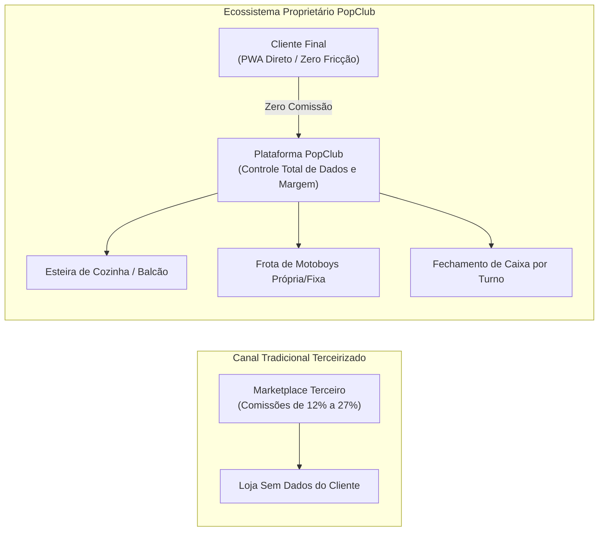
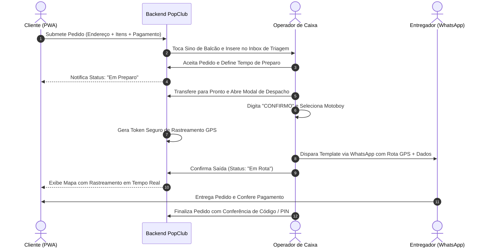
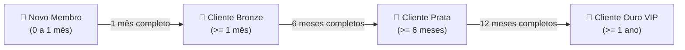
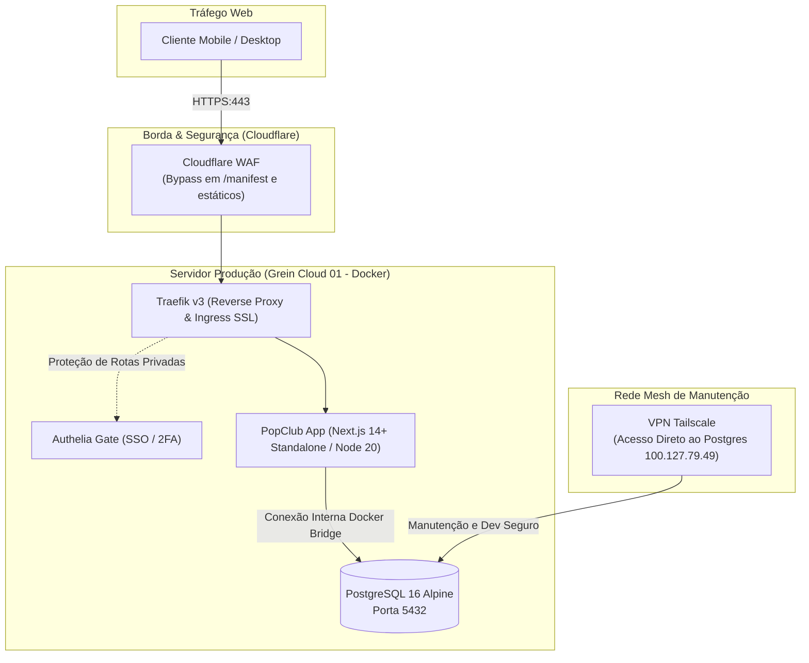
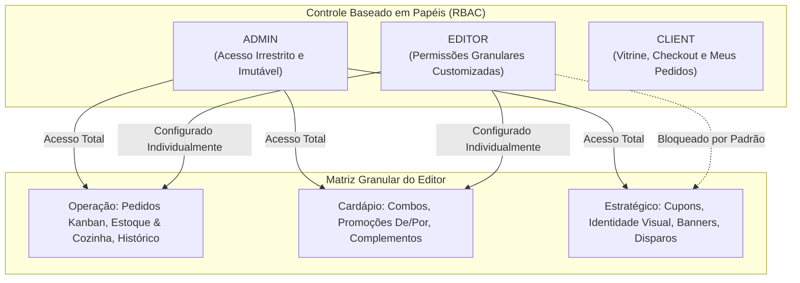

# DOCUMENTO EXECUTIVO DE ENGENHARIA E LEVANTAMENTO DE REQUISITOS
## Plataforma PopClub — Ecossistema Integrado de PWA Delivery, Gestão de Cozinha e Logística Operacional

---

### INFORMAÇÕES DE CONTROLE DO DOCUMENTO
- **Projeto:** PopClub (Pop Shake Sorveteria & Açaí Artesanal)
- **Versão:** 2.0.0
- **Status:** Aprovado / Homologado para Produção
- **Classificação:** Documento Técnico e Estratégico de Engenharia de Software
- **Autor / Responsável:** Engenharia de Requisitos, Arquitetura de Software e Operações
- **Ambiente Alvo:** Web / PWA Mobile (iOS/Android) e Terminais Desktop/Tablet de Balcão e Cozinha

---

## 1. INTRODUÇÃO E ESCOPO DO NEGÓCIO

### 1.1. Contexto & Oportunidade
A indústria de gastronomia e sobremesas geladas (especialmente operações focadas em açaí artesanal batido na hora, sorvetes e taças gourmet) enfrentou nos últimos anos um dilema estrutural de rentabilidade gerado pela dependência de marketplaces intermediários (como iFood, Rappi e Delivery Much). Essas plataformas impõem:
1. **Take-rates e Comissões Opressivas:** Taxas que variam entre 12% e 27% sobre o faturamento bruto de cada pedido, comprimindo as margens operacionais de produtos que já possuem custo de insumo elevado.
2. **Desapropriação da Base de Clientes:** O restaurante não possui acesso aos dados completos de seus consumidores (e-mails, números de contato direto e histórico de consumo), impedindo campanhas ativas de retenção e personalização.
3. **Falta de Ergonomia para Itens Altamente Perecíveis:** Os sistemas genéricos de delivery não atendem às particularidades térmicas de sobremesas geladas, que demandam controle minucioso do tempo decorrido entre a montagem, o acoplamento do entregador e a chegada à residência do cliente.

O projeto **PopClub** foi concebido como a resposta definitiva a esse cenário: um canal próprio de vendas diretas baseado na tecnologia **Progressive Web App (PWA)**, integrado a uma central operacional em tempo real para balcão, cozinha e despacho de motoboys. O PWA elimina a barreira de download das lojas de aplicativos tradicionais (Apple App Store e Google Play Store), permitindo acesso instantâneo via navegador com opção de instalação nativa na tela inicial do dispositivo do cliente.

---

### 1.2. Objetivos Estratégicos
O desenvolvimento e a implantação do PopClub norteiam-se por quatro metas quantitativas e qualitativas essenciais:

1. **Maximização da Margem Líquida por Pedido (Take-Rate Zero):** Redirecionar os clientes recorrentes para o canal proprietário, eliminando intermediários financeiros e custos ocultos de intermediação.
2. **Fidelização Contínua e Aumento de LTV (Lifetime Value):** Implementação de um programa nativo de retenção que recompensa o cliente por tempo de vínculo à marca, distribuindo cupons progressivos com travas de segurança contra uso indevido.
3. **Padronização e Agilidade da Linha de Produção:** Criação de uma esteira visual (Kanban) integrada a alertas sonoros no balcão e comandas térmicas padronizadas (58mm e 80mm), minimizando o tempo de montagem do açaí e evitando o derretimento do produto.
4. **Governança e Integridade Contábil por Expediente:** Segregação de todas as movimentações financeiras em turnos formais de operação, assegurando que o caixa físico, pagamentos em maquininhas de cartão e transferências Pix sejam conciliados e auditados antes do fechamento do dia.

---

### 1.3. Partes Interessadas (Stakeholders) e Personas

| Stakeholder / Persona | Perfil e Necessidades Principais | Ponto de Contato no Sistema |
| :--- | :--- | :--- |
| **Cliente Final — Acesso Rápido** *(Fast Access)* | Consumidor que busca velocidade máxima na primeira compra. Não deseja preencher formulários longos ou criar senhas. Exige escolha rápida de complementos e submissão com telefone e nome. | Vitrine do PWA, modal de personalização, checkout com criação automática de perfil temporário e avatar padrão. |
| **Cliente Final — Cadastrado** *(Fidelizado)* | Consumidor frequente que deseja acumular benefícios, salvar endereços recorrentes, consultar histórico de pedidos e utilizar cupons de desconto exclusivos atrelados ao seu nível de fidelidade. | Área logada `/conta`, visualização de selos de fidelidade (Novo, Bronze, Prata, Ouro VIP), carteira de endereços salvos. |
| **Operador de Caixa / Atendente** | Responsável pela triagem inicial dos pedidos, conferência de viabilidade de entrega, validação de valores de troco em dinheiro, comunicação com clientes e impressão de comprovantes térmicos. | Inbox de Triagem em `/admin/pedidos`, alertas sonoros de sino de cozinha, gaveta de detalhes do pedido, acionador de impressão de comanda. |
| **Equipe de Cozinha (Montagem)** | Colaboradores dedicados à preparação das tigelas, barcas e copos de açaí/sorvete. Precisam de visibilidade clara dos adicionais inclusos, itens pagos e observações, além da capacidade de suspender insumos esgotados instantaneamente. | Coluna "Em Preparo" do Kanban, switch operacional "Pausar na Cozinha" na gestão de complementos e estoque. |
| **Entregador (Courier / Motoboy)** | Profissional de entrega (próprio ou diarista parceiro) que recebe a rota GPS, dados de contato do cliente, valor a receber em dinheiro e link de rastreamento com atualização de localização. | Template de despacho enviado diretamente para o WhatsApp, link público de rastreamento `/entrega/[token]`. |
| **Administrador / Gestor do Negócio** | Proprietário ou gerente geral responsável pela abertura e fechamento de turnos, configuração de fretes georreferenciados, auditoria financeira de caixa, gestão de equipe e precificação do cardápio. | Painel Executivo `/admin`, módulo de turnos `/admin/historico`, gestão de usuários com matriz RBAC `/admin/usuarios`. |

---

## 2. REQUISITOS DE NEGÓCIO E OPERAÇÃO (ALÉM DO SOFTWARE)

### 2.1. Dinâmica de Cozinha e Ponto de Montagem

#### A. Tratamento de Produtos Perecíveis com Perda Térmica Crítica
Ao contrário de pizzarias ou hamburguerias, onde os produtos são servidos aquecidos e possuem tolerância térmica moderada, o açaí artesanal batido e o sorvete sofrem degradação imediata de textura, aeração e consistência se expostos à temperatura ambiente (especialmente no clima quente da região de Várzea Grande e Cuiabá - MT).
- O tempo máximo recomendado entre o término da montagem do pote e a saída da embalagem térmica com o motoboy é de **4 minutos**.
- O sistema deve segregar o fluxo entre o status `preparing` (em montagem na bancada refrigerada) e `ready` (embalado em saco térmico lacrado, aguardando acoplamento imediato do entregador).

#### B. Regra Operacional da "Pausa na Cozinha"
Durante os horários de pico, é comum o esgotamento repentino de adicionais altamente demandados (ex: leite em pó, morangos frescos, Nutella ou caldas especiais).
- **Diretriz de Operação:** O operador não deve precisar apagar complementos, editar preços ou republicar o cardápio para gerenciar faltas momentâneas.
- **Mecanismo Sistêmico:** A funcionalidade de "Pausa na Cozinha" fornece um interruptor (*toggle switch*) instantâneo nos módulos de adicionais e estoque. Ao pausar um item:
  1. Ele deixa de ser selecionável imediatamente nos modais de customização do PWA de todos os clientes conectados.
  2. Pedidos já submetidos que continham o item continuam preservados no histórico e nas comandas.
  3. Tentativas de finalização de checkout iniciadas antes da pausa com o item no carrinho são interceptadas no servidor com a mensagem: *"O complemento [Nome] está pausado na cozinha ou esgotado no momento."*

#### C. Embalagem Selada e Cálculo de Tempo Médio de Preparo
- Todo pedido deve ser despachado com lacre termocolante ou grampo inviolável para salvaguarda sanitária.
- O tempo de entrega informado ao cliente na vitrine (ex: "30-50 min") é dinamicamente ajustado no momento da abertura do turno ou adaptado pelo atendente no ato de aceitação do pedido na esteira de triagem, refletindo a saturação real da cozinha.

---

### 2.2. Modelo Logístico & Despacho de Corridas

#### A. Gestão de Frota Própria e Fixa de Motoboys
O sistema mantém uma base cadastral de entregadores com os seguintes dados operacionais:
- Nome completo e apelido de rádio.
- Número de WhatsApp formatado para deep-link internacional (`5565...`).
- Tipo de veículo (padrão: Moto) e placa identificadora para fins de segurança patrimonial.
- Chave Pix do profissional (para facilitar o acerto de diárias e repasse de fretes ao final do expediente).
- Status de disponibilidade no turno: `available` (na base), `in_transit` (em corrida) ou `off_duty` (fora da escala).

#### B. Raio de Cobertura Geográfica e Políticas de Frete
- **Ponto Focal da Loja:** Coordenadas de latitude e longitude da sede física da sorveteria (configuradas no banco de dados, ex: Várzea Grande, MT).
- **Raio Máximo de Atendimento:** Parâmetro editável em quilômetros (`maxDeliveryRadiusKm`). Endereços cuja distância geodésica (calculada pela fórmula de Haversine) ultrapasse o limite são impedidos de finalizar o checkout, instruindo o cliente a entrar em contato com o suporte.
- **Política de Frete:** Taxa fixa de entrega padrão (`deliveryFee`) com suporte a isenção (*Frete Grátis*) atrelada a um valor mínimo de subtotal de produtos (`freeDeliveryThreshold`).

#### C. Mecanismo de Despacho Ágil via WhatsApp
Para eliminar o custo de aplicativos dedicados a motoboys que consomem bateria excessiva e demandam treinamento complexo, o PopClub integra a expedição diretamente ao WhatsApp dos entregadores:
- Ao despachar o pedido no painel administrativo, o operador aciona um disparador que gera uma mensagem formatada contendo:
  1. Identificador curto do pedido (ex: `#A8F91B`).
  2. Nome do cliente e endereço completo (com complemento e ponto de referência).
  3. Link direto para o Google Maps com as coordenadas exatas da entrega.
  4. Valor total a cobrar e forma de pagamento (especificando se o cliente solicitou troco e o valor exato a ser devolvido).
  5. Link público de telemetria e rastreamento ao vivo (`/entrega/[trackingToken]`).

---

### 2.3. Gestão Financeira por Expediente (Controle de Turnos / Shifts)

A operação financeira da gastronomia de varejo não coincide com dias civis de calendário (00:00 às 23:59), mas sim com **turnos de atendimento** (que podem iniciar às 13:00 e avançar pela madrugada). O PopClub adota o conceito de isolamento financeiro estrito por turno.

#### A. Ciclo de Vida do Turno
- **Abertura:** O gestor abre o turno gerando um identificador exclusivo com máscara cronológica (`TURNO-YYYY-MM-DD-RANDOM`). Nesse momento, define-se o tempo padrão de entrega e observações da escala.
- **Operação Ativa:** Todos os pedidos submetidos durante a vigência do turno são carimbados com o `shiftId` correspondente.
- **Bloqueio Terminante para Encerramento:** O sistema **rejeita categoricamente** o fechamento do turno se houver qualquer pedido com status ativo na esteira (`pending`, `accepted`, `preparing`, `ready` ou `delivering`). O backend emite o código `PENDING_ORDERS_ACTIVE` com a lista dos pedidos em aberto, exigindo que sejam finalizados ou cancelados antes da liquidação contábil.
- **Fechamento Executivo:** Após a resolução de todos os pedidos ativos, o fechamento realiza:
  1. Apuração consolidada de receita total (`totalRevenue`).
  2. Totalização segregada por método de pagamento: `cashTotal` (dinheiro em espécie com conferência de troco), `pixTotal` (conferência bancária) e `cardTotal` (totalizadores da maquininha POS).
  3. Contagem de pedidos concluídos (`completedOrders`) e cancelados (`cancelledOrders`).
  4. Arquivamento em lote dos pedidos do turno (`isArchived: true`), limpando as esteiras operacionais para o próximo expediente sem apagar registros históricos.

#### B. Catálogo Padronizado de Ocorrências e Incidentes de Entrega
Quando uma corrida falha na ponta final com o entregador, o sistema veda anotações desestruturadas e exige a seleção de um motivo dentro do catálogo auditável (`DELIVERY_ISSUES`):

| Chave do Incidente | Título Operacional | Descrição do Cenário | Ações Permitidas |
| :--- | :--- | :--- | :--- |
| `CLIENTE_AUSENTE` | Cliente Ausente | Cliente não atende interfone, chamadas nem mensagens após tempo limite no portão. | Retornar para Preparo ou Cancelar |
| `ENDERECO_INCORRETO` | Endereço Incorreto | Logradouro não localizado, número não existe ou erro de geolocalização. | Retornar para Preparo ou Cancelar |
| `PEDIDO_AVARIADO` | Pedido Avariado | Avaria térmica, derretimento excessivo ou queda do recipiente durante o transporte. | Retornar para Cozinha (Refazer) |
| `RECUSA_CLIENTE` | Recusa do Cliente | Cliente recusa o pedido por tempo excessivo de espera ou desacordo do produto. | Cancelamento com Justificativa |
| `PROBLEMA_VEICULO` | Falha Mecânica | Pneu furado, colisão leve ou pane mecânica na motocicleta do entregador. | Retornar para Despacho / Troca de Motoboy |
| `SUSPEITA_GOLPE` | Suspeita de Fraude / Risco | Local de risco extremo, trote identificado ou ameaça à integridade do motoboy. | Cancelamento Imediato de Segurança |

---

### 2.4. Gamificação e Regras de Fidelidade

A retenção no PopClub baseia-se na valorização do tempo de relacionamento contínuo do cliente com a marca, calculando a idade da conta em meses corridos:

- **Novo Membro (Nível 1):** Conta recém-criada (menos de 1 mês). Acesso aos preços regulares do cardápio e cupons universais de boas-vindas.
- **Cliente Bronze (Nível 2):** Vínculo a partir de 1 mês completo. Acesso a cupons intermediários e promoções de frete reduzido.
- **Cliente Prata (Nível 3):** Vínculo a partir de 6 meses ininterruptos. Acesso a cupons de desconto expressivos e campanhas com brindes.
- **Cliente Ouro VIP (Nível 4):** Vínculo a partir de 12 meses (1 ano). Elegibilidade exclusiva para cupons de maior valor, atendimento prioritário e selo VIP destacado na conta.

#### Regras Anti-Fraude e Travas de Cupons
1. **Exigência de Cadastro Completo:** Cupons de desconto não podem ser aplicados por usuários de Acesso Rápido. O sistema barra a aplicação solicitando a conclusão do cadastro com CPF e senha (`COUPON_REQUIRES_REGISTRATION`).
2. **Proibição de "Double-Dipping":** É vedada a aplicação de cupons percentuais globais sobre carrinhos que já contenham "Combos Promocionais" ou barcas com desconto estrutural nativo, preservando a margem mínima de lucro.
3. **Uso Único por Cliente (`oncePerUser`):** Validação cruzada no banco de dados verificando tanto o `userId` quanto o número de telefone registrado no histórico de pedidos concluídos.

---

## 3. REQUISITOS DE HARDWARE, INFRAESTRUTURA E AMBIENTE OPERACIONAL

### 3.1. Equipamentos do Balcão e Cozinha
- **Terminais de Exibição:** Desktops, All-in-One ou Tablets Industriais (mínimo de 10 polegadas) fixados em suportes com orientação paisagem (*landscape*, resolução mínima de 1280x720 e recomendada 1920x1080).
- **Impressoras Térmicas de Cupom:**
  - Equipamentos compatíveis com protocolo de linha não-fiscal de 80mm (padrão EPSON TM-T20 / Bematech) e 58mm (mini impressoras térmicas de bancada).
  - Formatação tipográfica monoespaçada direta, gerando comprovantes com: data/hora, número do pedido, nome e telefone do cliente, discriminação de endereço/retirada, itens detalhados com adicionais inclusos e pagos, observações e forma de pagamento com detalhamento de troco.

---

### 3.2. Dispositivos dos Clientes e Entregadores
- **Smartphones e Tablets de Clientes:** Dispositivos móveis rodando Android (Google Chrome 90+) e iOS (Apple Safari 14+).
- **Tecnologia PWA:** Suporte a manifesto W3C (`manifest.webmanifest`), ícones de inicialização em múltiplas densidades (192px, 512px), tela de abertura (*splash screen* fluida) e capacidade de operação em tela cheia (*display: standalone*).
- **Dispositivos dos Entregadores:** Qualquer smartphone com suporte ao aplicativo WhatsApp e navegador para abertura do link de rota do Google Maps.

---

### 3.3. Infraestrutura de Servidores e DevOps

- **Topologia de Hospedagem:** Servidor VPS Ubuntu Server dedicado gerenciado via conteinerização Docker e orquestração Docker Compose.
- **Gerenciamento de Imagens e Portainer:** Pipeline de CI/CD automatizado via GitHub Actions que constrói a imagem Docker, publica no **GitHub Container Registry (GHCR)** e aciona o webhook do Portainer para deploy sem downtime (*rolling update*).
- **Camada de Borda (Cloudflare WAF):** Configuração de regras cirúrgicas de bypass para garantir que requisições ao manifesto PWA e ícones estáticos nunca sejam bloqueadas por desafios de bot (*Managed Challenge*), permitindo que qualquer smartphone instale o aplicativo instantaneamente.
- **Proxy Reverso (Traefik v3):** Emissão automática e renovação de certificados SSL/TLS via Let's Encrypt, roteamento por cabeçalhos de host e proteção das rotas de gestão.
- **Persistência de Dados (PostgreSQL 16 Alpine):** Volume persistente Docker com esquema gerenciado pelo **Prisma ORM**, aplicando migrações automáticas de schema na inicialização do container (`entrypoint.sh`). Acesso direto de desenvolvimento restrito à VPN **Tailscale**, eliminando portas de banco de dados abertas para a internet pública.

---

## 4. REQUISITOS LEGAIS, FISCAIS E DE SEGURANÇA (COMPLIANCE)

### 4.1. Conformidade com a LGPD (Lei Geral de Proteção de Dados - Lei 13.709/2018)
1. **Princípio da Minimização:** Coleta estrita dos dados necessários para a prestação do serviço de entrega (Nome, Telefone, Endereço e CPF para emissão de nota/conferência antifraude).
2. **Armazenamento Seguro de Documentos (CPF):**
   - Higienização e limpeza de pontuações de CPF antes da persistência no banco (`cleanCpf`).
   - Validação algorítmica rigorosa dos dois dígitos verificadores antes de autorizar qualquer cadastro (`validateCpf`).
   - Unicidade garantida por índice único no banco de dados (`@unique`).
3. **Direito ao Esquecimento e Política de Exclusão Lógica (*Soft Delete*):**
   - Conforme exigido pela legislação civil e tributária brasileira, dados fiscais e de faturamento de pedidos realizados devem ser custodiados por no mínimo 5 anos.
   - Quando um usuário solicita cancelamento ou exclusão de conta, o sistema **não realiza a exclusão física (*hard delete*)** do registro. Em vez disso, aplica o *Soft Delete*: o campo `deletedAt` recebe o timestamp da solicitação, `isActive` passa a `false`, o `tokenVersion` é incrementado (derrubando sessões imediatamente) e dados sensíveis de credenciais são desativados.
   - O histórico de pedidos permanece intacto para conciliações contábeis e auditorias de faturamento.

---

### 4.2. Segurança e Controle de Acesso (RBAC)

- **Papéis Primários (Roles):**
  - `ADMIN`: Acesso irrestrito a todos os módulos, fechamento de turnos, alteração de configurações de frete, criação de cupons e gestão de equipe. **Regra de Salvaguarda:** O sistema impede que o último administrador ativo seja excluído ou rebaixado.
  - `EDITOR`: Colaborador operacional com permissões concedidas de forma granular pelo Administrador através de chaves no campo `permissions: String[]`.
  - `CLIENT`: Usuário final restrito à navegação no cardápio, acompanhamento de seus próprios pedidos e atualização de seus dados cadastrais.
- **Invalidação Instantânea de Sessões (`tokenVersion`):** Cada usuário possui um contador numérico inteiro `tokenVersion`. Ao realizar logout em todos os dispositivos, alterar a senha ou ter sua conta bloqueada pelo administrador, o `tokenVersion` é incrementado atomicamente no banco. Qualquer JWT emitido anteriormente torna-se imediatamente inválido em todas as rotas de API.
- **Blindagem Anti-Tampering no Checkout:** Preços, taxas de frete, descontos de promoções e cotas de complementos gratuitos enviados pelo navegador do cliente são **completamente ignorados pelo backend**. O servidor consulta o banco de dados, recalcula todos os valores de forma independente e aborta a requisição caso detecte divergência de integridade.
- **Sanitização de Entradas (Anti-XSS):** Todas as strings recebidas nos corpos das requisições passam por rotinas de sanitização (`sanitizeText`), escapando tags HTML e caracteres maliciosos antes de qualquer gravação no banco de dados.

---

## 5. ESPECIFICAÇÃO DE REQUISITOS FUNCIONAIS (RF)

### 5.1. Módulo: Vitrine e Customização de Produtos (RF01 a RF06)

| ID | Nome do Requisito | Descrição Detalhada | Prioridade | Atores Envolvidos |
| :--- | :--- | :--- | :--- | :--- |
| **RF01** | Catálogo Dinâmico e Categorias | O sistema deve exibir produtos organizados por categorias dinâmicas (ex: Açaí no Copo, Taças, Gelatos, Barcas), exibindo nome, foto, preço base, selos visuais destacados e indicador de disponibilidade em tempo real. | **Must Have** | Cliente, Operador |
| **RF02** | Grupos de Complementos N:N | O sistema deve suportar a vinculação de múltiplos grupos de complementos a um produto (ex: Caldas, Frutas, Recheios), respeitando limites de seleção mínima (`minQuantity`), máxima (`maxQuantity`) e obrigatoriedade (`isRequired`). | **Must Have** | Cliente, Cozinha |
| **RF03** | Regras de Cotas Gratuitas e Adicionais | Cada grupo de complementos pode conter uma cota de itens inclusos gratuitamente no produto (`freeQuantity`). O sistema deve calcular automaticamente a gratuidade até o limite da cota e tarifar os itens excedentes pelo preço unitário cadastrado. | **Must Have** | Cliente, Operador |
| **RF04** | Modal de Customização de Produto | O sistema deve disponibilizar um modal interativo onde o cliente escolhe os adicionais com contadores numéricos, insere observações em texto livre para a cozinha e acompanha o subtotal recalculado em tempo real. | **Must Have** | Cliente |
| **RF05** | Carrinho de Compras Persistente | O carrinho do cliente deve persistir os itens selecionados em armazenamento local (`localStorage`), garantindo que o fechamento acidental da aba ou perda momentânea de conexão não resulte na perda das escolhas do usuário. | **Must Have** | Cliente |
| **RF06** | Gestão de Combos e Barcas Especiais | O sistema deve permitir a criação de "Combos Promocionais" agrupando múltiplos produtos em um pacote único com precificação especial diferenciada. | **Should Have** | Cliente, Administrador |

---

### 5.2. Módulo: Autenticação, Perfis e Fidelidade (RF07 a RF12)

| ID | Nome do Requisito | Descrição Detalhada | Prioridade | Atores Envolvidos |
| :--- | :--- | :--- | :--- | :--- |
| **RF07** | Fluxo de Acesso Rápido *(Fast Access)* | O sistema deve permitir a finalização de compras por clientes não previamente cadastrados, solicitando apenas Nome, Telefone de contato e Endereço de entrega, atribuindo um avatar aleatório padrão. | **Must Have** | Cliente Final |
| **RF08** | Cadastro Completo com Validação de CPF | O cliente pode registrar-se formalmente fornecendo Nome Completo, E-mail, Senha segura e CPF. O sistema deve validar matematicamente os dígitos verificadores do CPF e assegurar sua unicidade no banco. | **Must Have** | Cliente, Administrador |
| **RF09** | Níveis e Selos de Fidelidade Progressivos | O sistema deve calcular automaticamente a idade da conta do cliente e atribuir os selos correspondentes: Novo Membro (0m), Bronze (1m+), Prata (6m+) e Ouro VIP (12m+), exibindo o emblema no painel pessoal do usuário. | **Should Have** | Cliente |
| **RF10** | Aplicação de Cupons com Travas de Elegibilidade | O sistema deve validar cupons de desconto por código, checando data de validade, limite de usos global, valor mínimo do pedido, exclusividade para clientes cadastrados e elegibilidade pelo nível de fidelidade. | **Must Have** | Cliente, Administrador |
| **RF11** | Recuperação de Senha por Código | O sistema deve permitir que clientes cadastrados redefinam senhas esquecidas através de um código de verificação temporário com expiração programada (`resetCodeExpires`). | **Should Have** | Cliente |
| **RF12** | Catálogo de Avatares Temáticos Oficiais | O sistema deve disponibilizar um catálogo de avatares pré-definidos (ícones artesanais de açaí, taças, sorvetes e frutas) para que o cliente personalize seu perfil visual. | **Could Have** | Cliente, Administrador |

---

### 5.3. Módulo: Checkout, Frete e Rastreamento (RF13 a RF18)

| ID | Nome do Requisito | Descrição Detalhada | Prioridade | Atores Envolvidos |
| :--- | :--- | :--- | :--- | :--- |
| **RF13** | Gestão de Endereços com Geocodificação | O sistema deve permitir a inserção e salvamento de múltiplos endereços por usuário cadastrado, preenchendo automaticamente CEP, rua, bairro e cidade através de geocodificação reversa e API de busca. | **Must Have** | Cliente |
| **RF14** | Verificação de Raio Geográfico e Frete Grátis | O backend deve calcular a distância entre a sede da loja e o endereço do cliente. Se a distância estiver dentro de `maxDeliveryRadiusKm`, aplica a taxa de entrega ou zera o frete caso o subtotal atinja `freeDeliveryThreshold`. | **Must Have** | Cliente, Operador |
| **RF15** | Modalidades de Pagamento e Cálculo de Troco | O checkout deve oferecer as opções: Dinheiro (com campo obrigatório de troco e cálculo automático do valor a devolver), Cartão na Maquininha e Pix na Entrega (com conferência no ato). | **Must Have** | Cliente, Caixa, Motoboy |
| **RF16** | Submissão Transacional do Pedido | A criação do pedido deve ser executada dentro de uma transação atômica (`prisma.$transaction`), persistindo cabeçalho do pedido, itens individuais com snapshot dos adicionais pagos e vinculação ao turno aberto. | **Must Have** | Cliente, Backend |
| **RF17** | Linha do Tempo e Stepper em Tempo Real | O cliente deve acompanhar a evolução do pedido em uma linha do tempo com 5 estágios: Pedido Enviado, Aceito, Em Preparo na Cozinha, Saiu para Entrega e Concluído. | **Must Have** | Cliente |
| **RF18** | Rastreamento ao Vivo do Motoboy | Pedidos despachados com rastreamento GPS ativo devem disponibilizar uma página pública segura (`/entrega/[token]`) exibindo a localização do entregador em mapa interativo e o tempo estimado de chegada. | **Should Have** | Cliente, Motoboy |

---

### 5.4. Módulo: Painel Operacional & Esteira Kanban (RF19 a RF25)

| ID | Nome do Requisito | Descrição Detalhada | Prioridade | Atores Envolvidos |
| :--- | :--- | :--- | :--- | :--- |
| **RF19** | Inbox de Triagem com Alerta Sonoro | Pedidos com status `pending` devem aparecer na barra de triagem superior acompanhados pelo toque sonoro de sino de cozinha a cada 10 segundos até serem aceitos ou rejeitados pelo operador. | **Must Have** | Atendente, Caixa |
| **RF20** | Aceitação de Pedido e Estimativa de Tempo | Ao aceitar um novo pedido, o operador pode manter o tempo padrão do turno ou ajustar a estimativa de entrega (ex: 20-30 min, 35-50 min, 50-70 min), notificando o cliente instantaneamente. | **Must Have** | Atendente, Cozinha |
| **RF21** | Rejeição de Pedido com Motivo Padronizado | O operador pode rejeitar um pedido pendente selecionando um motivo da lista padronizada (ex: produto esgotado, fora do raio, cozinha sobrecarregada), liberando o status com justificativa clara. | **Must Have** | Atendente, Cliente |
| **RF22** | Esteira Kanban da Cozinha | Os pedidos aceitos devem fluir visualmente em colunas Kanban: "Fila", "Em Preparo", "Pronto / Aguardando Despacho" e "Em Rota", permitindo arrastar ou avançar com um clique. | **Must Have** | Equipe de Cozinha |
| **RF23** | Modal de Despacho com Confirmação Digitada | Para evitar despacho involuntário, a confirmação do despacho para a rota exige que o operador digite a palavra de segurança **"CONFIRMO"** e selecione o motoboy responsável pela entrega. | **Must Have** | Caixa, Motoboy |
| **RF24** | Inbox de Entrega e Conferência de PIN | Pedidos em rota devem permanecer visíveis na Inbox de Entrega com contador de tempo decorrido. A conclusão exige a confirmação do código do motoboy ou PIN de 4 dígitos do pedido. | **Must Have** | Caixa, Motoboy |
| **RF25** | Registro de Incidentes de Transporte | Caso o motoboy reporte problemas no trajeto, o operador deve registrar o incidente pelo diálogo padronizado (`DELIVERY_ISSUES`) e decidir entre reenviar para a cozinha (`reprepare`) ou cancelar (`cancel`). | **Must Have** | Caixa, Cozinha |

---

### 5.5. Módulo: Gestão Administrativa, Usuários & Turnos (RF26 a RF32)

| ID | Nome do Requisito | Descrição Detalhada | Prioridade | Atores Envolvidos |
| :--- | :--- | :--- | :--- | :--- |
| **RF26** | Abertura e Monitoramento de Turnos | O administrador ou editor autorizado deve abrir o turno diário, gerando o identificador do expediente e definindo o tempo de entrega e notas do dia. | **Must Have** | Administrador, Gestor |
| **RF27** | Fechamento de Turno com Trava de Segurança | O sistema deve impedir terminantemente o fechamento do turno se houver pedidos ativos na esteira (`PENDING_ORDERS_ACTIVE`), listando as pendências a serem resolvidas. | **Must Have** | Administrador, Gestor |
| **RF28** | Conciliação e Arquivamento do Expediente | Ao fechar o turno, o sistema calcula o faturamento total e a quebra por Dinheiro, Pix e Cartão, arquivando em lote todos os pedidos do expediente (`isArchived: true`). | **Must Have** | Administrador |
| **RF29** | Gestão de Equipe com Matriz RBAC | O administrador pode cadastrar usuários da equipe, definir papéis (`ADMIN`, `EDITOR`, `CLIENT`) e marcar individualmente as permissões modulares de cada editor. | **Must Have** | Administrador |
| **RF30** | Controle de Estoque e Pausa Instantânea | O operador de estoque pode ajustar quantidades de produtos e complementos ou acionar o switch "Pausar na Cozinha", desativando itens instantaneamente da vitrine do cliente. | **Must Have** | Cozinha, Estoquista |
| **RF31** | Cadastro e Escala da Frota de Motoboys | Módulo dedicado para cadastrar motoboys, gerenciar placas, chaves Pix para acerto de diárias e alternar o status entre disponível, em rota ou folga. | **Must Have** | Gestor, Logística |
| **RF32** | Dossiê do Cliente e Histórico Gerencial | O gestor pode consultar a ficha completa de qualquer cliente, incluindo valor total acumulado (LTV), ticket médio, frequência de pedidos, histórico de ocorrências e endereços utilizados. | **Should Have** | Administrador |

---

## 6. ESPECIFICAÇÃO DE REQUISITOS NÃO-FUNCIONAIS (RNF)

### 6.1. Desempenho e Eficiência (RNF01 a RNF04)

| ID | Requisito Não-Funcional | Métrica / Critério de Aceitação | Mecanismo de Implementação |
| :--- | :--- | :--- | :--- |
| **RNF01** | Tempo de Carregamento da Vitrine PWA | Largest Contentful Paint (LCP) inferior a **1.2 segundos** e First Contentful Paint (FCP) inferior a **0.8 segundos** em conexões 4G móveis. | Build standalone do Next.js, code-splitting agressivo por rota e server-side rendering (SSR) otimizado. |
| **RNF02** | Otimização de Ativos e Imagens | Todas as fotografias do cardápio e banners devem ser servidas em formato **WebP** com compressão balanceada e dimensões responsivas. | Componente `next/image` com redimensionamento dinâmico e armazenamento de avatares em SVG vetorial. |
| **RNF03** | Consumo Enxuto de Memória do Servidor | O container Node.js da aplicação em produção não deve ultrapassar **250MB de uso de RAM** em carga normal de expediente. | Compilação em modo Next.js Standalone, descartando bibliotecas pesadas de desenvolvimento no container final. |
| **RNF04** | Latência de Resposta de APIs Críticas | Tempo de processamento de checkout e triagem inferior a **200 milissegundos** no percentil 95 (P95). | Pool de conexões otimizado no Prisma ORM e consultas indexadas no PostgreSQL 16. |

---

### 6.2. Usabilidade e Ergonomia Visual (RNF05 a RNF08)

| ID | Requisito Não-Funcional | Métrica / Critério de Aceitação | Mecanismo de Implementação |
| :--- | :--- | :--- | :--- |
| **RNF05** | Suporte a Temas sem Degradação de Contraste | A aplicação deve suportar Modo Claro e Modo Escuro (*Dark Mode*) rigoroso, atendendo ao nível **WCAG AA** de contraste de cores (mínimo 4.5:1). | Uso estrito de variáveis CSS de design tokens (`hsl(var(--foreground))`, etc.), eliminando estilos inline com cores pretas fixas sobre fundos escuros. |
| **RNF06** | Ergonomia Touch-First para Dispositivos Móveis | Todos os elementos clicáveis da vitrine móvel devem possuir área mínima de toque de **48x48 pixels**, com espaçamento adequado contra toques falsos. | Padding generoso em botões, controles de quantidade flutuantes e gavetas (*drawers*) inferiores com suporte a deslize para fechar (*swipe-to-dismiss*). |
| **RNF07** | Densidade de Informação em Telas de Cozinha | O painel operacional deve aproveitar telas amplas (tablets e monitores landscape) exibindo a esteira Kanban completa sem necessidade de rolagem horizontal. | Layout CSS Grid responsivo com colunas compactas, cards de pedidos com tipografia legível à distância de 1 metro na bancada. |
| **RNF08** | Feedback Imediato Sonoro e Háptico | Ações críticas (novo pedido recebido, pedido despachado, item pausado) devem disparar feedback visual (toasts) e sonoro instantâneo. | Biblioteca de síntese Web Audio API nativa para o sino de balcão (`sound.ts`), dispensando downloads de arquivos MP3 pesados. |

---

### 6.3. Confiabilidade, Integridade e Tolerância a Falhas (RNF09 a RNF12)

| ID | Requisito Não-Funcional | Métrica / Critério de Aceitação | Mecanismo de Implementação |
| :--- | :--- | :--- | :--- |
| **RNF09** | Atomicidade em Operações Financeiras e de Estoque | Operações de submissão de pedidos, encerramento de turnos e cancelamentos devem ser estritamente atômicas (tudo ou nada). | Encapsulamento de escritas críticas em blocos transacionais `prisma.$transaction`. |
| **RNF10** | Isolamento e Resiliência da Camada de Banco | A camada de banco de dados deve operar isolada em rede interna Docker, imune a acessos diretos da internet. | Acesso local de manutenção restrito à malha VPN privada Tailscale (WireGuard) sem exposição de portas no roteador de borda. |
| **RNF11** | Tolerância a Quedas Temporárias de Conexão | O cliente no PWA não deve perder os itens montados no carrinho caso o sinal de internet móvel sofra oscilação momentânea durante a montagem. | Persistência local reativa dos estados do carrinho com sincronização assíncrona automática ao restabelecer o sinal. |
| **RNF12** | Autocura e Deploy Idempotente | O container da aplicação deve ser capaz de reiniciar e auto-recuperar o estado da esteira de pedidos sem inconsistências de schema. | Script de entrada `entrypoint.sh` com verificação ativa de prontidão do banco (`nc`/fallback Node) e execução automática de migrações (`prisma migrate deploy`). |

---

### 6.4. Segurança e Hardening (RNF13 a RNF16)

| ID | Requisito Não-Funcional | Métrica / Critério de Aceitação | Mecanismo de Implementação |
| :--- | :--- | :--- | :--- |
| **RNF13** | Armazenamento Criptográfico Forte de Senhas | Todas as senhas de usuários cadastrados devem ser transformadas em hashes irreversíveis com algoritmo seguro. | Emprego da biblioteca `bcryptjs` com fator de trabalho (*salt rounds*) configurado em 10. |
| **RNF14** | Proteção contra Força Bruta e Sobrecarga (Rate Limiting) | Rotas sensíveis devem possuir limitadores estritos de requisições por IP: Checkout (10 req/min), Login/Auth (5 req/min) e Cupons (10 req/min). | Classe `RateLimiter` em memória com extração do IP real através do cabeçalho de borda `cf-connecting-ip`. |
| **RNF15** | Revogação Dinâmica de Tokens JWT | Capacidade de invalidar instantaneamente todos os tokens ativos de um usuário em caso de suspeita de fraude ou troca de credenciais. | Validação do campo `tokenVersion` no payload do JWT contra o valor atual registrado no banco a cada requisição autenticada. |
| **RNF16** | Prevenção contra Injeção de Código (XSS e SQLi) | Nenhuma entrada fornecida por usuários pode ser renderizada sem escape ou concatenada em consultas de banco. | Consultas tipadas e parametrizadas via Prisma ORM e rotinas de sanitização recursiva de payloads (`sanitizePayload`). |

---

## 7. MATRIZ DE RASTREABILIDADE

A matriz abaixo estabelece a correlação bidirecional entre as necessidades operacionais de negócio, os requisitos funcionais e não-funcionais especificados, os componentes de software no código-fonte e as entidades correspondentes no esquema do banco de dados (`prisma/schema.prisma`):

| Necessidade de Negócio | Requisito Funcional (RF) | Requisito Não-Funcional (RNF) | Módulo / Componente no Código | Entidade no Banco de Dados (`schema.prisma`) |
| :--- | :--- | :--- | :--- | :--- |
| **Controle de Perecíveis e Insumos** | RF02, RF03, RF04, RF30 | RNF04, RNF07, RNF08 | `src/components/admin/AddonsManagement.tsx` `src/components/admin/StockControlSection.tsx` `src/components/storefront/ProductDetailModal.tsx` | `Product`, `AddonGroup`, `AddonItem`, `ProductAddonGroup` |
| **Cardápio e Vendas Promocionais** | RF01, RF05, RF06 | RNF01, RNF02, RNF05 | `src/app/carrinho/page.tsx` `src/components/storefront/ProductCard.tsx` `src/components/admin/CombosManagementSection.tsx` | `Category`, `Product`, `ComboItem`, `Promotion`, `CardBadge` |
| **Acesso Rápido e Cadastro Seguro** | RF07, RF08, RF11, RF12 | RNF13, RNF14, RNF15 | `src/components/auth/FastAccessModal.tsx` `src/components/auth/RegisterModal.tsx` `src/app/api/auth/register/route.ts` | `User` (campos `cpf`, `passwordHash`, `isRegistered`, `tokenVersion`) |
| **Retenção e Gamificação** | RF09, RF10 | RNF05, RNF14 | `src/services/loyaltyBadgeService.ts` `src/components/admin/LoyaltyBadgesSection.tsx` `src/components/admin/CouponFormDialog.tsx` | `Coupon`, `NotificationTemplate` (categoria `loyalty_badges`) |
| **Logística e Despacho de Corridas** | RF13, RF14, RF18, RF31 | RNF04, RNF06, RNF08 | `src/components/admin/LogisticsAndCouriersSection.tsx` `src/components/admin/OrderDispatchDialog.tsx` `src/components/logistics/LocationPickerMap.tsx` | `Courier`, `StoreSettings`, `UserLocation` |
| **Triagem e Esteira da Cozinha** | RF19, RF20, RF21, RF22 | RNF07, RNF08, RNF09 | `src/components/admin/OrderTriageBar.tsx` `src/components/admin/OrderKanbanColumn.tsx` `src/lib/thermalPrinter.ts` | `Order` (`status`), `OrderItem` |
| **Auditoria e Finalização de Rota** | RF23, RF24, RF25 | RNF08, RNF09, RNF16 | `src/components/admin/OrderDeliveryInbox.tsx` `src/components/admin/OrderDeliveryIssueDialog.tsx` `src/app/api/orders/[id]/route.ts` | `Order` (`deliveryIssue`, `deliveryIssueNotes`, `courierCode`, `orderPin`) |
| **Gestão de Turnos e Conciliação** | RF26, RF27, RF28, RF32 | RNF09, RNF10, RNF12 | `src/services/shiftService.ts` `src/app/api/shifts/route.ts` `src/app/admin/historico/page.tsx` | `Shift`, `StoreSettings` (`currentShiftId`), `Order` (`shiftId`, `isArchived`) |
| **Segurança e Matriz de Permissões** | RF29 | RNF15, RNF16 | `src/lib/permissions.ts` `src/components/admin/UsersManagementSection.tsx` `src/app/api/admin/users/route.ts` | `User` (`role`, `permissions`, `isActive`, `deletedAt`) |
| **Checkout Seguro Anti-Tampering** | RF15, RF16, RF17 | RNF04, RNF09, RNF14 | `src/app/api/checkout/route.ts` `src/lib/rateLimit.ts` `src/app/rastreamento/page.tsx` | `Order`, `OrderItem`, `Coupon` |

---

### HISTÓRICO DE APROVAÇÕES E REVISÕES
- **Revisão Técnica:** Engenharia de Software e Arquitetura de Sistemas
- **Homologação Operacional:** Gerência de Atendimento e Produção de Cozinha
- **Conformidade e Segurança:** Auditoria de Dados e Governança LGPD
- **Documentação de Referência:** Diretrizes de implantação em `docs/ARCHITECTURE.md` e especificações de identidade visual em `docs/VISUAL_IDENTITY_AUDIT.md`.
