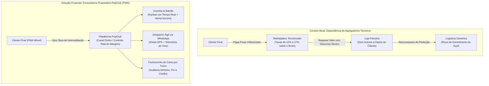
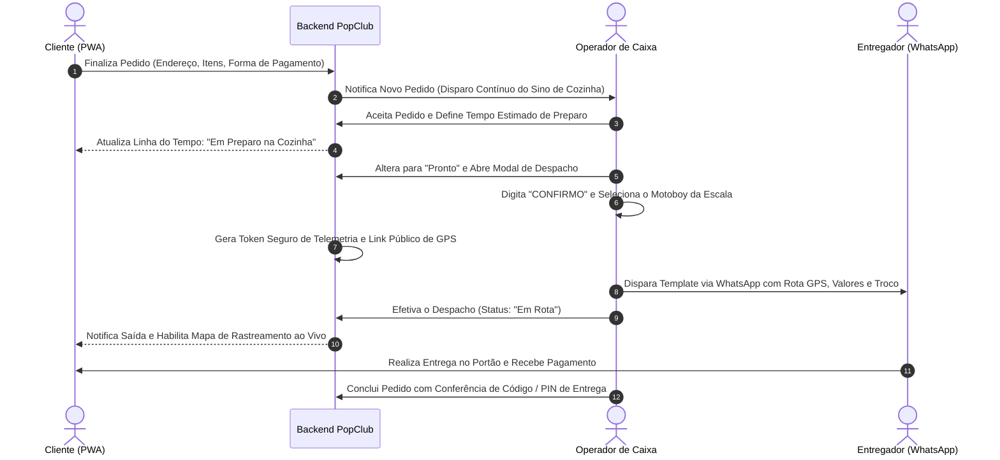
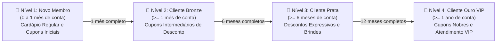
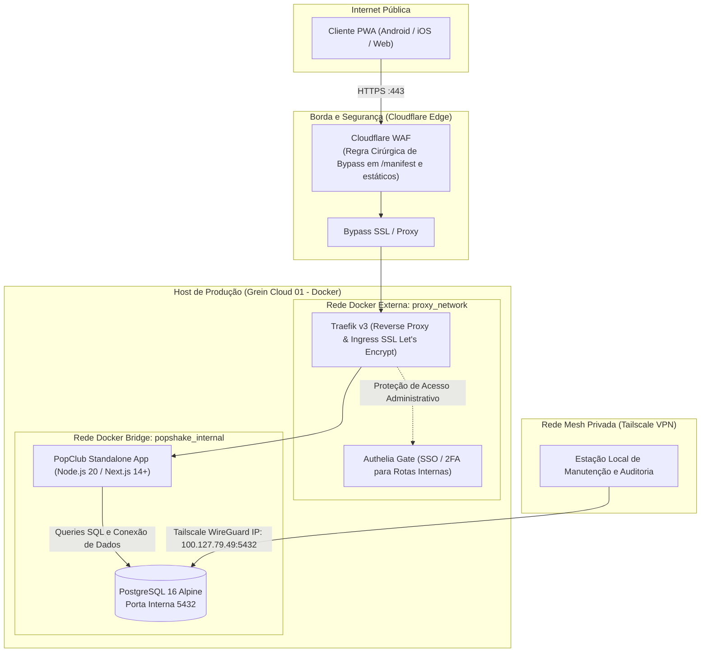
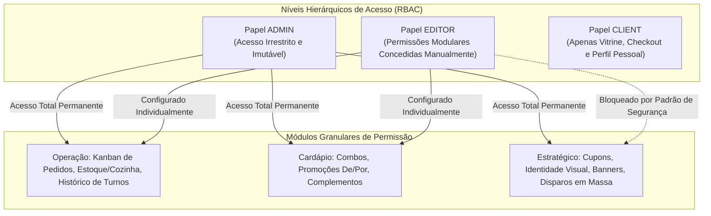

# CENTRO UNIVERSITÁRIO DE VÁRZEA GRANDE — UNIVAG
## CURSO DE TECNOLOGIA EM ANÁLISE E DESENVOLVIMENTO DE SISTEMAS
### PROJETO EXTENSIONISTA INTEGRADOR
### DESENVOLVIMENTO DE PROGRESSIVE WEB APPS (PWAs) COM FRAMEWORKS AVANÇADOS (2026/2)

   

# POPCLUB: PLATAFORMA DE DELIVERY PWA E GESTÃO OPERACIONAL
## Relatório Periódico 1 (RP1): Levantamento de Requisitos, Arquitetura e Validação Operacional

    

**Autor:** Wilton Gabriel Albuquerque Pereira  
**Matrícula / Identificação:** Acadêmico do Curso de Análise e Desenvolvimento de Sistemas  
**Instituição de Ensino Superior:** Centro Universitário de Várzea Grande (UNIVAG)  
**Entidade Parceira / Cliente:** Pop Shake Sorveteria & Açaí Artesanal  
**Área de Aplicação:** Gastronomia Comercial, Logística Urbana de Delivery e Engenharia de Software  

    

**VÁRZEA GRANDE – MT**  
**2026**

---

## SUMÁRIO

1. **[1. INTRODUÇÃO E JUSTIFICATIVA DO PROJETO](#1-introdução-e-justificativa-do-projeto)**
   - 1.1. Contexto do Problema e Caracterização da Entidade Parceira
   - 1.2. Justificativa de Negócio, Social e Pedagógica
   - 1.3. Objetivos do Projeto (Geral e Específicos)
   - 1.4. Mapeamento de Partes Interessadas (Stakeholders) e Personas
2. **[2. REQUISITOS DE NEGÓCIO E MODELO OPERACIONAL](#2-requisitos-de-negócio-e-modelo-operacional)**
   - 2.1. Dinâmica da Cozinha, Perecibilidade Térmica e Ponto de Montagem
   - 2.2. Modelo Logístico e Despacho de Corridas
   - 2.3. Gestão Financeira por Expediente (Controle de Turnos Operacionais)
   - 2.4. Gamificação e Regras de Retenção e Fidelidade
3. **[3. REQUISITOS DE HARDWARE, AMBIENTE E INFRAESTRUTURA](#3-requisitos-de-hardware-ambiente-e-infraestrutura)**
   - 3.1. Equipamentos do Ponto de Venda (PDV), Balcão e Cozinha
   - 3.2. Dispositivos dos Consumidores e Entregadores
   - 3.3. Topologia de Infraestrutura, Nuvem e DevOps
4. **[4. REQUISITOS LEGAIS, FISCAIS E SEGURANÇA (COMPLIANCE)](#4-requisitos-legais-fiscais-e-segurança-compliance)**
   - 4.1. Conformidade com a Lei Geral de Proteção de Dados (LGPD)
   - 4.2. Controle de Acesso Baseado em Papéis (RBAC) e Blindagem Anti-Tampering
5. **[5. ESPECIFICAÇÃO DOS REQUISITOS FUNCIONAIS (RF)](#5-especificação-dos-requisitos-funcionais-rf)**
   - 5.1. Módulo: Vitrine e Customização de Produtos (RF01 a RF06)
   - 5.2. Módulo: Autenticação, Perfis e Fidelidade (RF07 a RF12)
   - 5.3. Módulo: Checkout, Frete e Rastreamento (RF13 a RF18)
   - 5.4. Módulo: Painel Operacional & Esteira Kanban (RF19 a RF25)
   - 5.5. Módulo: Gestão Administrativa, Usuários & Turnos (RF26 a RF32)
6. **[6. ESPECIFICAÇÃO DOS REQUISITOS NÃO-FUNCIONAIS (RNF)](#6-especificação-dos-requisitos-não-funcionais-rnf)**
   - 6.1. Desempenho e Eficiência (RNF01 a RNF04)
   - 6.2. Usabilidade e Ergonomia Visual (RNF05 a RNF08)
   - 6.3. Confiabilidade, Integridade e Tolerância a Falhas (RNF09 a RNF12)
   - 6.4. Segurança e Hardening (RNF13 a RNF16)
7. **[7. MATRIZ DE RASTREABILIDADE BIDIRECIONAL](#7-matriz-de-rastreabilidade-bidirecional)**
8. **[8. FEEDBACK DOS USUÁRIOS E VALIDAÇÃO COM O CLIENTE PARCEIRO](#8-feedback-dos-usuários-e-validação-com-o-cliente-parceiro)**
   - 8.1. Metodologia de Testes e Imersão em Campo
   - 8.2. Resultados dos Testes de Usabilidade da Vitrine PWA
   - 8.3. Avaliação da Esteira Operacional de Cozinha e Balcão
   - 8.4. Síntese dos Feedbacks Coletados e Melhorias Incorporadas
   - 8.5. Indicadores de Aceitação Operacional
9. **[9. REFERÊNCIAS](#9-referências)**

---

## 1. INTRODUÇÃO E JUSTIFICATIVA DO PROJETO

### 1.1. Contexto do Problema e Caracterização da Entidade Parceira
O comércio varejista de alimentos, especialmente no segmento de sobremesas geladas e açaí artesanal, desempenha papel econômico fundamental na geração de renda e emprego em municípios como Várzea Grande e Cuiabá (Mato Grosso). A entidade parceira deste projeto extensionista, o estabelecimento comercial **Pop Shake Sorveteria & Açaí Artesanal**, opera com foco na preparação imediata de açaí batido na hora, gelatos artesanais, milkshakes e barcas temáticas.

Entretanto, a operação comercial da loja vinha enfrentando barreiras severas de crescimento e sustentabilidade decorrentes da dependência compulsória dos grandes marketplaces agregadores de delivery (como iFood e plataformas correlatas). O diagnóstico inicial do ecossistema identificou três fragilidades críticas:

1. **Margens Asfixiadas por Taxas Oligopolistas:** Os agregadores hegemônicos cobram comissões que variam entre 12% e 27% sobre o faturamento bruto de cada transação, além de mensalidades fixas para manutenção de loja virtual. Para itens cujo custo de mercadoria vendida (CMV) com frutas frescas, leites especiais e chocolates nobres já oscila entre 35% e 45%, essa intermediação reduz a margem operacional líquida do pequeno empresário a níveis críticos.
2. **Expropriação da Relação com a Base Consumidora:** Nas plataformas terceiras, o estabelecimento não tem acesso legítimo aos dados cadastrais dos clientes (e-mails, números de contato telefônico e hábitos de consumo). Tal barreira impede a criação de programas próprios de pós-venda, canais de suporte humanizado e campanhas direcionadas de retenção.
3. **Incompatibilidade com Produtos de Altíssima Perecibilidade Térmica:** O açaí batido artesanal e os sorvetes possuem um comportamento físico-químico particular: em ambientes de calor tropical intenso como a Baixada Cuiabana (onde temperaturas externas superam 38°C rotineiramente), o tempo limite entre a finalização da montagem na bancada refrigerada e a acomodação na embalagem térmica do entregador é de aproximadamente **4 minutos**. Aplicativos generalistas não oferecem esteira dedicada de sincronismo entre cozinha, balcão e motoboys, gerando frequentes reclamações de derretimento do produto e desperdício de insumos.

**Figura 1 – Modelo Tradicional de Intermediação versus Ecossistema Proprietário PopClub**

*Fonte: Elaborado pelos autores (2026).*

---

### 1.2. Justificativa de Negócio, Social e Pedagógica
A concepção da plataforma **PopClub** ancora-se na necessidade de promover a emancipação digital do pequeno empreendedor local, unindo rigor acadêmico em Engenharia de Software ao impacto extensionista comunitário:

- **Dimensão Econômica e de Negócio:** Ao implantar um canal de vendas direto via web aplicativo progressivo (PWA), a empresa parceira retém 100% da receita de seus pedidos (*take-rate zero*), permitindo praticar preços mais competitivos, investir na qualificação dos ingredientes e oferecer políticas atrativas de frete próprio.
- **Dimensão Social e Extensionista:** O projeto fomenta a retenção de riqueza na economia do município de Várzea Grande, melhora a renda dos entregadores locais parceiros (que recebem ordens claras de serviço com acerto de corridas transparente via Pix) e oferece ao cidadão consumidor um canal direto e seguro de atendimento.
- **Dimensão Pedagógica e Tecnológica:** A execução deste projeto viabiliza a aplicação prática dos conceitos fundamentais do curso de Análise e Desenvolvimento de Sistemas do UNIVAG, englobando elicitação e rastreabilidade de requisitos, modelagem relacional avançada com PostgreSQL e Prisma ORM, segurança da informação (LGPD, RBAC e criptografia bcrypt) e desenvolvimento de interfaces reativas com Next.js em modo Standalone de alta performance.

---

### 1.3. Objetivos do Projeto (Geral e Específicos)

#### Objetivo Geral
Projetar, especificar, desenvolver e implantar uma solução computacional completa composta por um **Progressive Web App (PWA)** de delivery para os consumidores e uma **Central Operacional em Tempo Real** para a gestão de pedidos, esteira de cozinha, logística de motoboys e fechamento de turnos financeiros da sorveteria parceira.

#### Objetivos Específicos
1. Realizar o levantamento detalhado e exaustivo dos requisitos de software, operacionais e de negócio que regem o ciclo de vida do pedido gastronômico perecível.
2. Desenvolver uma interface PWA responsiva com experiência visual refinada (suporte estrito aos modos claro e escuro sem perda de contraste), permitindo navegação fluida e compra rápida sem atrito cadastral compulsório (*Fast Access*).
3. Projetar uma esteira visual de produção baseada na metodologia Kanban para a cozinha, integrada a alertas sonoros e emissão padronizada de comandas térmicas (80mm e 58mm).
4. Implementar mecanismos de segurança contra fraudes no checkout (recálculo integral de preços no servidor) e conformidade integral com a Lei Geral de Proteção de Dados (LGPD) por meio de exclusão lógica (*soft delete*) e anonimização de credenciais.
5. Estruturar a gestão financeira por expedientes de trabalho (*shifts*), garantindo a conciliação rigorosa de numerário físico, transações de cartão e comprovantes Pix antes do encerramento de cada jornada.

---

### 1.4. Mapeamento de Partes Interessadas (Stakeholders) e Personas

**Tabela 1 – Partes Interessadas (Stakeholders) e Personas Operacionais**

| Stakeholder / Persona | Categoria | Papel Operacional e Necessidades no Ecossistema | Ponto de Contato com a Plataforma |
| :--- | :--- | :--- | :--- |
| **Cliente de Acesso Rápido** *(Fast Access)* | Externo | Consumidor ocasional ou de primeira viagem que exige velocidade absoluta. Rejeita o preenchimento de formulários longos e criação prévia de senhas. Necessita de identificação mínima (nome e telefone) e seleção ágil de complementos. | Vitrine do PWA, modal de personalização de itens, checkout simplificado com avatar lúdico gerado automaticamente. |
| **Cliente Cadastrado** *(Fidelizado)* | Externo | Cliente recorrente que busca acumular vantagens com o passar do tempo. Deseja histórico detalhado de compras, carteira de endereços salvos e acesso exclusivo a cupons progressivos baseados em seu tempo de relacionamento. | Área pessoal `/conta`, visualização de selos de fidelidade (Novo Membro, Bronze, Prata, Ouro VIP), cupons direcionados. |
| **Operador de Caixa / Atendente** | Interno | Responsável pela triagem inicial dos pedidos entrantes, validação de viabilidade de entrega, controle de troco para dinheiro físico, despacho de comandas térmicas e atendimento a dúvidas. | Barra de Triagem em `/admin/pedidos`, acionamento sonoro do sino de balcão, gaveta de detalhes e módulo de impressão térmica. |
| **Equipe de Cozinha (Montagem)** | Interno | Operadores de bancada encarregados da manipulação e montagem das taças e copos de açaí/gelato. Necessitam de visibilidade clara de adicionais inclusos, itens cobrados e do recurso de suspensão imediata de insumos esgotados. | Coluna "Em Preparo" do Kanban de pedidos, switch instantâneo "Pausar na Cozinha" no controle de complementos e estoque. |
| **Entregador (Courier / Motoboy)** | Operacional | Profissional de entrega (próprio ou fixo da escala) que necessita de dados consolidados de rota (geolocalização e referências), valor a cobrar, troco a devolver e instruções claras de corrida. | Template de despacho via WhatsApp com link direto de rota no Google Maps e página de telemetria pública `/entrega/[token]`. |
| **Administrador / Gestor Geral** | Gerencial | Proprietário ou gerente encarregado da abertura e fechamento de turnos diários, conciliação do caixa por método de pagamento, auditoria financeira, precificação do cardápio e gestão de permissões de equipe. | Painel Executivo `/admin`, módulo de turnos em `/admin/historico`, gestão granular de equipe e usuários em `/admin/usuarios`. |

*Fonte: Elaborado pelos autores (2026).*

---

## 2. REQUISITOS DE NEGÓCIO E MODELO OPERACIONAL

### 2.1. Dinâmica da Cozinha, Perecibilidade Térmica e Ponto de Montagem
O fluxo de produção de sobremesas geladas possui restrições operacionais significativamente mais severas do que a culinária convencional aquecida:

1. **Sensibilidade Térmica Extrema:** O açaí batido na textura cremosa padrão e os gelatos iniciam processo acelerado de desestabilização de estrutura e derretimento dentro de **4 minutos** quando submetidos à temperatura ambiente média regional (35°C a 40°C). Dessa forma, a esteira não pode permitir que o pedido permaneça finalizado na bancada aguardando indefinidamente a chegada do entregador. O status `ready` sinaliza que o pote foi selado com lacre inviolável e alocado temporariamente em freezer de espera ou mochila térmica do entregador já presente no balcão.
2. **Regra de "Pausa na Cozinha":** Durante picos de demanda (finais de semana e noites de calor intenso), insumos específicos (como morango fresco, leite em pó Ninho ou marcas nobres de creme de avelã) esgotam-se subitamente. A regra de negócio proíbe terminantemente a exclusão do produto ou recriação do catálogo. A cozinha aciona o botão de alternância (*toggle switch*) "Pausar na Cozinha". Instantaneamente, o complemento torna-se indisponível para seleção no PWA de todos os clientes, sem afetar pedidos em preparação e sem alterar preços históricos.
3. **Cálculo Dinâmico do Tempo de Espera:** Na abertura do turno ou no ato de aceite de cada pedido, o operador ajusta a previsão estimada (presets: 20-30 min, 35-50 min, 50-70 min). O PWA reflete essa estimativa instantaneamente no cabeçalho e na tela de rastreamento do cliente.

---

### 2.2. Modelo Logístico e Despacho de Corridas

**Figura 2 – Fluxo Operacional de Despacho de Corridas e Notificação via WhatsApp**

*Fonte: Elaborado pelos autores (2026).*

1. **Cadastro da Frota Fixa:** Manutenção de cadastro com nome do profissional, telefone com código de área, placa do veículo, tipo de transporte e chave Pix para acerto consolidado das corridas no encerramento da jornada.
2. **Raio de Atendimento Georreferenciado:** O sistema calcula a distância esférica entre as coordenadas da sede da loja (configurada no banco de dados) e as coordenadas geodésicas fornecidas pelo cliente no momento da compra (fórmula de Haversine). Caso a distância exceda `maxDeliveryRadiusKm` (padrão de 10 km), a submissão é bloqueada, orientando o cliente para contato com a loja.
3. **Política de Isenção de Frete:** Taxa de frete padrão (`deliveryFee`) calculada com regra automática de frete grátis caso o subtotal atinja o piso estipulado em `freeDeliveryThreshold`.
4. **Despacho Direto via WhatsApp:** Ao invés de exigir aplicativos complexos que consomem bateria excessiva dos entregadores, o sistema formata uma mensagem de alta densidade no WhatsApp do motoboy contendo: número do pedido, identificação do cliente, endereço completo com referências, link de rota direta para o Google Maps, valor total a cobrar, indicação de troco a devolver e link seguro de telemetria `/entrega/[token]`.

---

### 2.3. Gestão Financeira por Expediente (Controle de Turnos Operacionais)
No comércio gastronômico de sobremesas, os horários de operação ultrapassam a meia-noite civil, iniciando comumente à tarde e estendendo-se pela madrugada. A integridade contábil exige que os lançamentos pertençam a um **Turno de Trabalho (*Shift*)**, e não a um dia de calendário arbitrário.

#### A. Trava de Segurança e Bloqueio Terminante de Fechamento
Para evitar furos de caixa ou pedidos esquecidos na bancada, o sistema aplica um **bloqueio terminante de fechamento**. O encerramento do expediente é categoricamente recusado com o código `PENDING_ORDERS_ACTIVE` caso exista qualquer pedido ativo na esteira (seja em triagem, em preparação na cozinha, pronto aguardando motoboy ou em trânsito com o entregador). O gestor deve obrigatoriamente concluir ou cancelar cada pendência antes de fechar o turno.

#### B. Conciliação Executiva Multimodal
Ao validar o fechamento, o sistema calcula de forma segregada:
- **Total em Dinheiro (`cashTotal`):** Montante em papel-moeda físico que deve estar presente na gaveta do caixa, considerando o valor cobrado e abatendo eventuais trocos devolvidos.
- **Total em Pix (`pixTotal`):** Lançamentos transferidos diretamente para a conta bancária da empresa, conferidos mediante comprovante.
- **Total em Cartão (`cardTotal`):** Totalizadores dos terminais POS de cartão débito/crédito levados pelos motoboys na entrega.
- **Arquivamento em Lote:** O fechamento marca todos os pedidos do expediente como arquivados (`isArchived: true`), garantindo que o painel da cozinha e do balcão inicie o próximo turno limpo e sem poluição visual.

#### C. Catálogo Auditável de Incidentes de Transporte

**Tabela 2 – Catálogo Padronizado de Incidentes e Ocorrências de Entrega**

| Código do Incidente | Título do Evento | Descrição do Cenário Real | Ação Corretiva Permitida |
| :--- | :--- | :--- | :--- |
| `CLIENTE_AUSENTE` | Cliente Ausente | Entregador aguarda no endereço, mas o cliente não atende chamadas, campainha ou interfone. | Reenviar para Preparo ou Cancelar |
| `ENDERECO_INCORRETO` | Endereço Incorreto | Logradouro inexistente, numeração divergente ou erro crasso de geolocalização do cliente. | Reenviar para Preparo ou Cancelar |
| `PEDIDO_AVARIADO` | Pedido Avariado | Avaria térmica (derretimento excessivo) ou tombamento do recipiente durante o transporte. | Reenviar para Cozinha (Refazer Imediatamente) |
| `RECUSA_CLIENTE` | Recusa do Cliente | Consumidor recusa o recebimento por atraso excessivo de rota ou divergência de itens. | Cancelamento com Justificativa Auditável |
| `PROBLEMA_VEICULO` | Falha Mecânica | Pneu furado, colisão leve ou pane mecânica na motocicleta durante o trajeto de entrega. | Retornar para Despacho (Troca de Entregador) |
| `SUSPEITA_GOLPE` | Suspeita de Risco / Trote | Local de alta periculosidade, suspeita de trote de segurança ou ameaça à integridade do motoboy. | Cancelamento Imediato por Segurança |

*Fonte: Elaborado pelos autores (2026).*

---

### 2.4. Gamificação e Regras de Retenção e Fidelidade

**Figura 3 – Jornada de Fidelização Progressiva por Idade de Conta**

*Fonte: Elaborado pelos autores (2026).*

1. **Cálculo Dinâmico por Idade de Conta:** A elegibilidade do cliente a categorias de fidelidade é mensurada pelo tempo contínuo de existência de sua conta (`calculateAccountAgeMonths`), categorizando-o em: Novo Membro, Cliente Bronze, Cliente Prata e Cliente Ouro VIP.
2. **Travas Antifraude em Cupons de Desconto:**
   - **Exigência de Cadastro Completo:** Cupons de desconto não podem ser aplicados por usuários de Acesso Rápido. O sistema exige a formalização do cadastro com CPF e senha (`COUPON_REQUIRES_REGISTRATION`).
   - **Proibição de "Double-Dipping":** Bloqueio estrito da aplicação de cupons percentuais sobre pedidos que já contenham "Combos Promocionais" com preços promocionais de fábrica.
   - **Validação de Uso Único (`oncePerUser`):** Checagem cruzada simultânea por `userId` e número de telefone celular registrado no histórico contábil.
3. **Confirmação Manual Digitada para Parâmetros Críticos:** Alterações estruturais no painel de gestão de taxas de frete ou de selos de fidelidade exigem que o gestor digite manualmente a palavra de segurança **"SIM"** para efetivar a gravação, eliminando toques ou cliques involuntários.

---

## 3. REQUISITOS DE HARDWARE, AMBIENTE E INFRAESTRUTURA

### 3.1. Equipamentos do Ponto de Venda (PDV), Balcão e Cozinha
- **Terminais de Exibição:** Desktops convencionais, All-in-One ou Tablets Industriais (telas mínimas de 10 polegadas) dispostos em orientação paisagem (*landscape*, 1280x720 a 1920x1080), permitindo a visualização panorâmica da esteira Kanban sem necessidade de rolagem horizontal constante.
- **Impressoras Térmicas Não-Fiscais:**
  - Compatibilidade garantida com bobinas térmicas de 80mm e 58mm.
  - Diagramação tipográfica monoespaçada direta (`Courier New`), com cortes verticais contendo dados do cliente, endereço, itens agrupados, adicionais inclusos/pagos, observações para montagem e totais de conferência financeira.

---

### 3.2. Dispositivos dos Consumidores e Entregadores
- **Smartphones e Tablets de Consumidores:** Dispositivos rodando Android (navegador Google Chrome 90+) e iOS (Apple Safari 14+).
- **Recursos PWA Suportados:** Manifesto W3C (`manifest.webmanifest`), ícones de alta densidade (192px e 512px), cache local de assets via Service Worker e capacidade de instalação nativa na tela de início (*Add to Home Screen*) sem intermediários de lojas de aplicativos.
- **Dispositivos dos Entregadores:** Qualquer aparelho com capacidade de conexão móvel 3G/4G/5G, aplicativo WhatsApp instalado e suporte a visualização de mapas no Google Maps.

---

### 3.3. Topologia de Infraestrutura, Nuvem e DevOps

**Figura 4 – Topologia de Infraestrutura de Servidores e Redes**

*Fonte: Elaborado pelos autores (2026).*

- **Conteinerização Docker e Deploy Automatizado:** Aplicação compilada em modo **Next.js Standalone**, minimizando a imagem Docker e o consumo de memória RAM (inferior a 250MB em carga operacional). Atualização contínua através do **Portainer** acoplado ao **GitHub Container Registry (GHCR)**.
- **Bypass Cirúrgico no Cloudflare WAF:** As rotas vitais do PWA (`/manifest.webmanifest`, `/favicon.ico`, `/icons/*`, `/_next/static/*`) possuem regras explícitas de bypass de desafios antibot, garantindo que o instalador do smartphone nunca sofra bloqueios ou atrasos.
- **Segurança da Camada de Dados via Tailscale:** A porta `5432` do banco PostgreSQL não fica exposta para a internet aberta. Acesso para manutenção e suporte ocorre exclusivamente por túnel criptografado WireGuard da VPN **Tailscale** no IP privado `100.127.79.49`.

---

## 4. REQUISITOS LEGAIS, FISCAIS E SEGURANÇA (COMPLIANCE)

### 4.1. Conformidade com a Lei Geral de Proteção de Dados (LGPD)
A plataforma foi desenhada atendendo às determinações da Lei Federal nº 13.709/2018 (LGPD):

1. **Tratamento Rigoroso de Documentos Pessoais (CPF):**
   - Limpeza e extração dos caracteres de formatação (`cleanCpf`).
   - Validação matemática de unicidade e consistência dos dois dígitos verificadores antes da gravação (`validateCpf`).
   - Bloqueio de cadastros duplicados através de restrição única no banco relacional.
2. **Exclusão Lógica e Retenção Fiscal (*Soft Delete*):**
   - Em observância à legislação tributária e ao Código de Defesa do Consumidor (que exigem a custódia de transações comerciais por período mínimo de 5 anos), a inativação ou solicitação de cancelamento de conta pelo usuário aciona o *Soft Delete*:
     * O campo `deletedAt` recebe o registro cronológico da requisição e `isActive` é definido como `false`.
     * O `tokenVersion` é incrementado atomicamente, derrubando imediatamente todas as sessões ativas do usuário.
     * Os registros de pedidos passados, itens consumidos e faturamento são preservados para fins de prestação de contas fiscais.

---

### 4.2. Controle de Acesso Baseado em Papéis (RBAC) e Blindagem Anti-Tampering

**Figura 5 – Matriz de Controle de Acesso Baseado em Papéis (RBAC)**

*Fonte: Elaborado pelos autores (2026).*

- **Papéis do Sistema:**
  - `ADMIN`: Administrador geral do negócio. Acesso integral a todas as abas e relatórios. **Salvaguarda do Sistema:** O software veda expressamente a exclusão ou despromoção do último administrador ativo da base.
  - `EDITOR`: Colaborador operacional com permissões moduladas em array `permissions: String[]`. Por padrão seguro (*secure by default*), as abas estratégicas (cupons, banners, disparos e canais de pagamento) vêm bloqueadas.
  - `CLIENT`: Acesso estritamente restrito à navegação, carrinho e visualização de seus próprios pedidos.
- **Invalidação Instantânea de Sessões (`tokenVersion`):** Cada usuário possui um versionador de credenciais no banco. Em casos de redefinição de senha, bloqueio administrativo ou logout global, o valor de `tokenVersion` é incrementado, rejeitando qualquer JWT antigo em frações de segundo.
- **Blindagem Anti-Tampering (Integridade de Preços no Checkout):** O backend ignora integralmente preços unitários, subtotais ou taxas de frete calculadas no frontend do navegador. Toda a composição de valores é recalculada a partir do banco de dados na rota `/api/checkout`, impedindo ataques de injeção ou manipulação de parâmetros monetários.

---

## 5. ESPECIFICAÇÃO DOS REQUISITOS FUNCIONAIS (RF)

### 5.1. Módulo: Vitrine e Customização de Produtos (RF01 a RF06)

**Tabela 3 – Requisitos Funcionais: Vitrine e Customização de Produtos (RF01 a RF06)**

| ID | Nome do Requisito | Descrição Detalhada da Funcionalidade | Prioridade | Atores Envolvidos |
| :--- | :--- | :--- | :--- | :--- |
| **RF01** | Catálogo Dinâmico e Categorias | O sistema deve exibir produtos organizados por categorias dinâmicas (ex: Açaí no Copo, Taças, Gelatos, Barcas), exibindo nome, foto, preço base, selos visuais destacados e indicador de disponibilidade em tempo real. | **Must Have** | Cliente, Operador |
| **RF02** | Grupos de Complementos N:N | O sistema deve suportar a vinculação de múltiplos grupos de complementos a um produto (ex: Caldas, Frutas, Recheios), respeitando limites de seleção mínima (`minQuantity`), máxima (`maxQuantity`) e obrigatoriedade (`isRequired`). | **Must Have** | Cliente, Cozinha |
| **RF03** | Regras de Cotas Gratuitas e Adicionais | Cada grupo de complementos pode conter uma cota de itens inclusos gratuitamente no produto (`freeQuantity`). O sistema deve calcular automaticamente a gratuidade até o limite da cota e tarifar os itens excedentes pelo preço unitário cadastrado. | **Must Have** | Cliente, Operador |
| **RF04** | Modal de Customização de Produto | O sistema deve disponibilizar um modal interativo onde o cliente escolhe os adicionais com contadores numéricos, insere observações em texto livre para a cozinha e acompanha o subtotal recalculado em tempo real. | **Must Have** | Cliente |
| **RF05** | Carrinho de Compras Persistente | O carrinho do cliente deve persistir os itens selecionados em armazenamento local (`localStorage`), garantindo que o fechamento acidental da aba ou perda momentânea de conexão não resulte na perda das escolhas do usuário. | **Must Have** | Cliente |
| **RF06** | Gestão de Combos e Barcas Especiais | O sistema deve permitir a criação de "Combos Promocionais" agrupando múltiplos produtos em um pacote único com precificação especial diferenciada. | **Should Have** | Cliente, Administrador |

*Fonte: Elaborado pelos autores (2026).*

---

### 5.2. Módulo: Autenticação, Perfis e Fidelidade (RF07 a RF12)

**Tabela 4 – Requisitos Funcionais: Autenticação, Perfis e Fidelidade (RF07 a RF12)**

| ID | Nome do Requisito | Descrição Detalhada da Funcionalidade | Prioridade | Atores Envolvidos |
| :--- | :--- | :--- | :--- | :--- |
| **RF07** | Fluxo de Acesso Rápido *(Fast Access)* | O sistema deve permitir a finalização de compras por clientes não previamente cadastrados, solicitando apenas Nome, Telefone de contato e Endereço de entrega, atribuindo um avatar aleatório padrão. | **Must Have** | Cliente Final |
| **RF08** | Cadastro Completo com Validação de CPF | O cliente pode registrar-se formalmente fornecendo Nome Completo, E-mail, Senha segura e CPF. O sistema deve validar matematicamente os dígitos verificadores do CPF e assegurar sua unicidade no banco. | **Must Have** | Cliente, Administrador |
| **RF09** | Níveis e Selos de Fidelidade Progressivos | O sistema deve calcular automaticamente a idade da conta do cliente e atribuir os selos correspondentes: Novo Membro (0m), Bronze (1m+), Prata (6m+) e Ouro VIP (12m+), exibindo o emblema no painel pessoal do usuário. | **Should Have** | Cliente |
| **RF10** | Aplicação de Cupons com Travas de Elegibilidade | O sistema deve validar cupons de desconto por código, checando data de validade, limite de usos global, valor mínimo do pedido, exclusividade para clientes cadastrados e elegibilidade pelo nível de fidelidade. | **Must Have** | Cliente, Administrador |
| **RF11** | Recuperação de Senha por Código | O sistema deve permitir que clientes cadastrados redefinam senhas esquecidas através de um código de verificação temporário com expiração programada (`resetCodeExpires`). | **Should Have** | Cliente |
| **RF12** | Catálogo de Avatares Temáticos Oficiais | O sistema deve disponibilizar um catálogo de avatares pré-definidos (ícones artesanais de açaí, taças, sorvetes e frutas) para que o cliente personalize seu perfil visual. | **Could Have** | Cliente, Administrador |

*Fonte: Elaborado pelos autores (2026).*

---

### 5.3. Módulo: Checkout, Frete e Rastreamento (RF13 a RF18)

**Tabela 5 – Requisitos Funcionais: Checkout, Frete e Rastreamento (RF13 a RF18)**

| ID | Nome do Requisito | Descrição Detalhada da Funcionalidade | Prioridade | Atores Envolvidos |
| :--- | :--- | :--- | :--- | :--- |
| **RF13** | Gestão de Endereços com Geocodificação | O sistema deve permitir a inserção e salvamento de múltiplos endereços por usuário cadastrado, preenchendo automaticamente CEP, rua, bairro e cidade através de geocodificação reversa e API de busca. | **Must Have** | Cliente |
| **RF14** | Verificação de Raio Geográfico e Frete Grátis | O backend deve calcular a distância entre a sede da loja e o endereço do cliente. Se a distância estiver dentro de `maxDeliveryRadiusKm`, aplica a taxa de entrega ou zera o frete caso o subtotal atinja `freeDeliveryThreshold`. | **Must Have** | Cliente, Operador |
| **RF15** | Modalidades de Pagamento e Cálculo de Troco | O checkout deve oferecer as opções: Dinheiro (com campo obrigatório de troco e cálculo automático do valor a devolver), Cartão na Maquininha e Pix na Entrega (com conferência no ato). | **Must Have** | Cliente, Caixa, Motoboy |
| **RF16** | Submissão Transacional do Pedido | A criação do pedido deve ser executada dentro de uma transação atômica (`prisma.$transaction`), persistindo cabeçalho do pedido, itens individuais com snapshot dos adicionais pagos e vinculação ao turno aberto. | **Must Have** | Cliente, Backend |
| **RF17** | Linha do Tempo e Stepper em Tempo Real | O cliente deve acompanhar a evolução do pedido em uma linha do tempo com 5 estágios: Pedido Enviado, Aceito, Em Preparo na Cozinha, Saiu para Entrega e Concluído. | **Must Have** | Cliente |
| **RF18** | Rastreamento ao Vivo do Motoboy | Pedidos despachados com rastreamento GPS ativo devem disponibilizar uma página pública segura (`/entrega/[token]`) exibindo a localização do entregador em mapa interativo e o tempo estimado de chegada. | **Should Have** | Cliente, Motoboy |

*Fonte: Elaborado pelos autores (2026).*

---

### 5.4. Módulo: Painel Operacional & Esteira Kanban (RF19 a RF25)

**Tabela 6 – Requisitos Funcionais: Painel Operacional & Esteira Kanban (RF19 a RF25)**

| ID | Nome do Requisito | Descrição Detalhada da Funcionalidade | Prioridade | Atores Envolvidos |
| :--- | :--- | :--- | :--- | :--- |
| **RF19** | Inbox de Triagem com Alerta Sonoro | Pedidos com status `pending` devem aparecer na barra de triagem superior acompanhados pelo toque sonoro de sino de cozinha a cada 10 segundos até serem aceitos ou rejeitados pelo operador. | **Must Have** | Atendente, Caixa |
| **RF20** | Aceitação de Pedido e Estimativa de Tempo | Ao aceitar um novo pedido, o operador pode manter o tempo padrão do turno ou ajustar a estimativa de entrega (ex: 20-30 min, 35-50 min, 50-70 min), notificando o cliente instantaneamente. | **Must Have** | Atendente, Cozinha |
| **RF21** | Rejeição de Pedido com Motivo Padronizado | O operador pode rejeitar um pedido pendente selecionando um motivo da lista padronizada (ex: produto esgotado, fora do raio, cozinha sobrecarregada), liberando o status com justificativa clara. | **Must Have** | Atendente, Cliente |
| **RF22** | Esteira Kanban da Cozinha | Os pedidos aceitos devem fluir visualmente em colunas Kanban: "Fila", "Em Preparo", "Pronto / Aguardando Despacho" e "Em Rota", permitindo arrastar ou avançar com um clique. | **Must Have** | Equipe de Cozinha |
| **RF23** | Modal de Despacho com Confirmação Digitada | Para evitar despacho involuntário, a confirmação do despacho para a rota exige que o operador digite a palavra de segurança **"CONFIRMO"** e selecione o motoboy responsável pela entrega. | **Must Have** | Caixa, Motoboy |
| **RF24** | Inbox de Entrega e Conferência de PIN | Pedidos em rota devem permanecer visíveis na Inbox de Entrega com contador de tempo decorrido. A conclusão exige a confirmação do código do motoboy ou PIN de 4 dígitos do pedido. | **Must Have** | Caixa, Motoboy |
| **RF25** | Registro de Incidentes de Transporte | Caso o motoboy reporte problemas no trajeto, o operador deve registrar o incidente pelo diálogo padronizado (`DELIVERY_ISSUES`) e decidir entre reenviar para a cozinha (`reprepare`) ou cancelar (`cancel`). | **Must Have** | Caixa, Cozinha |

*Fonte: Elaborado pelos autores (2026).*

---

### 5.5. Módulo: Gestão Administrativa, Usuários & Turnos (RF26 a RF32)

**Tabela 7 – Requisitos Funcionais: Gestão Administrativa, Usuários & Turnos (RF26 a RF32)**

| ID | Nome do Requisito | Descrição Detalhada da Funcionalidade | Prioridade | Atores Envolvidos |
| :--- | :--- | :--- | :--- | :--- |
| **RF26** | Abertura e Monitoramento de Turnos | O administrador ou editor autorizado deve abrir o turno diário, gerando o identificador do expediente e definindo o tempo de entrega e notas do dia. | **Must Have** | Administrador, Gestor |
| **RF27** | Fechamento de Turno com Trava de Segurança | O sistema deve impedir terminantemente o fechamento do turno se houver pedidos ativos na esteira (`PENDING_ORDERS_ACTIVE`), listando as pendências a serem resolvidas. | **Must Have** | Administrador, Gestor |
| **RF28** | Conciliação e Arquivamento do Expediente | Ao fechar o turno, o sistema calcula o faturamento total e a quebra por Dinheiro, Pix e Cartão, arquivando em lote todos os pedidos do expediente (`isArchived: true`). | **Must Have** | Administrador |
| **RF29** | Gestão de Equipe com Matriz RBAC | O administrador pode cadastrar usuários da equipe, definir papéis (`ADMIN`, `EDITOR`, `CLIENT`) e marcar individualmente as permissões modulares de cada editor. | **Must Have** | Administrador |
| **RF30** | Controle de Estoque e Pausa Instantânea | O operador de estoque pode ajustar quantidades de produtos e complementos ou acionar o switch "Pausar na Cozinha", desativando itens instantaneamente da vitrine do cliente. | **Must Have** | Cozinha, Estoquista |
| **RF31** | Cadastro e Escala da Frota de Motoboys | Módulo dedicado para cadastrar motoboys, gerenciar placas, chaves Pix para acerto de diárias e alternar o status entre disponível, em rota ou folga. | **Must Have** | Gestor, Logística |
| **RF32** | Dossiê do Cliente e Histórico Gerencial | O gestor pode consultar a ficha completa de qualquer cliente, incluindo valor total acumulado (LTV), ticket médio, frequência de pedidos, histórico de ocorrências e endereços utilizados. | **Should Have** | Administrador |

*Fonte: Elaborado pelos autores (2026).*

---

## 6. ESPECIFICAÇÃO DOS REQUISITOS NÃO-FUNCIONAIS (RNF)

### 6.1. Desempenho e Eficiência (RNF01 a RNF04)

**Tabela 8 – Requisitos Não-Funcionais: Desempenho e Eficiência (RNF01 a RNF04)**

| ID | Requisito Não-Funcional | Métrica / Critério de Aceitação | Mecanismo de Implementação |
| :--- | :--- | :--- | :--- |
| **RNF01** | Tempo de Carregamento da Vitrine PWA | Largest Contentful Paint (LCP) inferior a **1.2 segundos** e First Contentful Paint (FCP) inferior a **0.8 segundos** em conexões 4G móveis. | Build standalone do Next.js, code-splitting agressivo por rota e server-side rendering (SSR) otimizado. |
| **RNF02** | Otimização de Ativos e Imagens | Todas as fotografias do cardápio e banners devem ser servidas em formato **WebP** com compressão balanceada e dimensões responsivas. | Componente `next/image` com redimensionamento dinâmico e armazenamento de avatares em SVG vetorial. |
| **RNF03** | Consumo Enxuto de Memória do Servidor | O container Node.js da aplicação em produção não deve ultrapassar **250MB de uso de RAM** em carga normal de expediente. | Compilação em modo Next.js Standalone, descartando bibliotecas pesadas de desenvolvimento no container final. |
| **RNF04** | Latência de Resposta de APIs Críticas | Tempo de processamento de checkout e triagem inferior a **200 milissegundos** no percentil 95 (P95). | Pool de conexões otimizado no Prisma ORM e consultas indexadas no PostgreSQL 16. |

*Fonte: Elaborado pelos autores (2026).*

---

### 6.2. Usabilidade e Ergonomia Visual (RNF05 a RNF08)

**Tabela 9 – Requisitos Não-Funcionais: Usabilidade e Ergonomia Visual (RNF05 a RNF08)**

| ID | Requisito Não-Funcional | Métrica / Critério de Aceitação | Mecanismo de Implementação |
| :--- | :--- | :--- | :--- |
| **RNF05** | Suporte a Temas sem Degradação de Contraste | A aplicação deve suportar Modo Claro e Modo Escuro (*Dark Mode*) rigoroso, atendendo ao nível **WCAG AA** de contraste de cores (mínimo 4.5:1). | Uso estrito de variáveis CSS de design tokens (`hsl(var(--foreground))`, etc.), eliminando estilos inline com cores pretas fixas sobre fundos escuros. |
| **RNF06** | Ergonomia Touch-First para Dispositivos Móveis | Todos os elementos clicáveis da vitrine móvel devem possuir área mínima de toque de **48x48 pixels**, com espaçamento adequado contra toques falsos. | Padding generoso em botões, controles de quantidade flutuantes e gavetas (*drawers*) inferiores com suporte a deslize para fechar (*swipe-to-dismiss*). |
| **RNF07** | Densidade de Informação em Telas de Cozinha | O painel operacional deve aproveitar telas amplas (tablets e monitores landscape) exibindo a esteira Kanban completa sem necessidade de rolagem horizontal. | Layout CSS Grid responsivo com colunas compactas, cards de pedidos com tipografia legível à distância de 1 metro na bancada. |
| **RNF08** | Feedback Imediato Sonoro e Háptico | Ações críticas (novo pedido recebido, pedido despachado, item pausado) devem disparar feedback visual (toasts) e sonoro instantâneo. | Biblioteca de síntese Web Audio API nativa para o sino de balcão (`sound.ts`), dispensando downloads de arquivos MP3 pesados. |

*Fonte: Elaborado pelos autores (2026).*

---

### 6.3. Confiabilidade, Integridade e Tolerância a Falhas (RNF09 a RNF12)

**Tabela 10 – Requisitos Não-Funcionais: Confiabilidade, Integridade e Tolerância a Falhas (RNF09 a RNF12)**

| ID | Requisito Não-Funcional | Métrica / Critério de Aceitação | Mecanismo de Implementação |
| :--- | :--- | :--- | :--- |
| **RNF09** | Atomicidade em Operações Financeiras e de Estoque | Operações de submissão de pedidos, encerramento de turnos e cancelamentos devem ser estritamente atômicas (tudo ou nada). | Encapsulamento de escritas críticas em blocos transacionais `prisma.$transaction`. |
| **RNF10** | Isolamento e Resiliência da Camada de Banco | A camada de banco de dados deve operar isolada em rede interna Docker, imune a acessos diretos da internet. | Acesso local de manutenção restrito à malha VPN privada Tailscale (WireGuard) sem exposição de portas no roteador de borda. |
| **RNF11** | Tolerância a Quedas Temporárias de Conexão | O cliente no PWA não deve perder os itens montados no carrinho caso o sinal de internet móvel sofra oscilação momentânea durante a montagem. | Persistência local reativa dos estados do carrinho com sincronização assíncrona automática ao restabelecer o sinal. |
| **RNF12** | Autocura e Deploy Idempotente | O container da aplicação deve ser capaz de reiniciar e auto-recuperar o estado da esteira de pedidos sem inconsistências de schema. | Script de entrada `entrypoint.sh` com verificação ativa de prontidão do banco (`nc`/fallback Node) e execução automática de migrações (`prisma migrate deploy`). |

*Fonte: Elaborado pelos autores (2026).*

---

### 6.4. Segurança e Hardening (RNF13 a RNF16)

**Tabela 11 – Requisitos Não-Funcionais: Segurança e Hardening (RNF13 a RNF16)**

| ID | Requisito Não-Funcional | Métrica / Critério de Aceitação | Mecanismo de Implementação |
| :--- | :--- | :--- | :--- |
| **RNF13** | Armazenamento Criptográfico Forte de Senhas | Todas as senhas de usuários cadastrados devem ser transformadas em hashes irreversíveis com algoritmo seguro. | Emprego da biblioteca `bcryptjs` com fator de trabalho (*salt rounds*) configurado em 10. |
| **RNF14** | Proteção contra Força Bruta e Sobrecarga (Rate Limiting) | Rotas sensíveis devem possuir limitadores estritos de requisições por IP: Checkout (10 req/min), Login/Auth (5 req/min) e Cupons (10 req/min). | Classe `RateLimiter` em memória com extração do IP real através do cabeçalho de borda `cf-connecting-ip`. |
| **RNF15** | Revogação Dinâmica de Tokens JWT | Capacidade de invalidar instantaneamente todos os tokens ativos de um usuário em caso de suspeita de fraude ou troca de credenciais. | Validação do campo `tokenVersion` no payload do JWT contra o valor atual registrado no banco a cada requisição autenticada. |
| **RNF16** | Prevenção contra Injeção de Código (XSS e SQLi) | Nenhuma entrada fornecida por usuários pode ser renderizada sem escape ou concatenada em consultas de banco. | Consultas tipadas e parametrizadas via Prisma ORM e rotinas de sanitização recursiva de payloads (`sanitizePayload`). |

*Fonte: Elaborado pelos autores (2026).*

---

## 7. MATRIZ DE RASTREABILIDADE BIDIRECIONAL

**Tabela 12 – Matriz de Rastreabilidade Bidirecional de Requisitos**

| Necessidade de Negócio / Operação | Requisito Funcional (RF) | Requisito Não-Funcional (RNF) | Módulo / Componente no Código-Fonte | Entidade no Banco de Dados (`schema.prisma`) |
| :--- | :--- | :--- | :--- | :--- |
| **Controle de Perecíveis e Insumos** | RF02, RF03, RF04, RF30 | RNF04, RNF07, RNF08 | `src/components/admin/AddonsManagement.tsx` `src/components/admin/StockControlSection.tsx` `src/components/storefront/ProductDetailModal.tsx` | `Product`, `AddonGroup`, `AddonItem`, `ProductAddonGroup` |
| **Cardápio e Vendas Promocionais** | RF01, RF05, RF06 | RNF01, RNF02, RNF05 | `src/app/carrinho/page.tsx` `src/components/storefront/ProductCard.tsx` `src/components/admin/CombosManagementSection.tsx` | `Category`, `Product`, `ComboItem`, `Promotion`, `CardBadge` |
| **Acesso Rápido e Cadastro Seguro** | RF07, RF08, RF11, RF12 | RNF13, RNF14, RNF15 | `src/components/auth/FastAccessModal.tsx` `src/components/auth/RegisterModal.tsx` `src/app/api/auth/register/route.ts` | `User` (campos `cpf`, `passwordHash`, `isRegistered`, `tokenVersion`) |
| **Retenção e Gamificação** | RF09, RF10 | RNF05, RNF14 | `src/services/loyaltyBadgeService.ts` `src/components/admin/LoyaltyBadgesSection.tsx` `src/components/admin/CouponFormDialog.tsx` | `Coupon`, `NotificationTemplate` (categoria `loyalty_badges`) |
| **Logística e Despacho de Corridas** | RF13, RF14, RF18, RF31 | RNF04, RNF06, RNF08 | `src/components/admin/LogisticsAndCouriersSection.tsx` `src/components/admin/OrderDispatchDialog.tsx` `src/components/logistics/LocationPickerMap.tsx` | `Courier`, `StoreSettings`, `UserLocation` |
| **Triagem e Esteira da Cozinha** | RF19, RF20, RF21, RF22 | RNF07, RNF08, RNF09 | `src/components/admin/OrderTriageBar.tsx` `src/components/admin/OrderKanbanColumn.tsx` `src/lib/thermalPrinter.ts` | `Order` (`status`), `OrderItem` |
| **Auditoria e Finalização de Rota** | RF23, RF24, RF25 | RNF08, RNF09, RNF16 | `src/components/admin/OrderDeliveryInbox.tsx` `src/components/admin/OrderDeliveryIssueDialog.tsx` `src/app/api/orders/[id]/route.ts` | `Order` (`deliveryIssue`, `deliveryIssueNotes`, `courierCode`, `orderPin`) |
| **Gestão de Turnos e Conciliação** | RF26, RF27, RF28, RF32 | RNF09, RNF10, RNF12 | `src/services/shiftService.ts` `src/app/api/shifts/route.ts` `src/app/admin/historico/page.tsx` | `Shift`, `StoreSettings` (`currentShiftId`), `Order` (`shiftId`, `isArchived`) |
| **Segurança e Matriz de Permissões** | RF29 | RNF15, RNF16 | `src/lib/permissions.ts` `src/components/admin/UsersManagementSection.tsx` `src/app/api/admin/users/route.ts` | `User` (`role`, `permissions`, `isActive`, `deletedAt`) |
| **Checkout Seguro Anti-Tampering** | RF15, RF16, RF17 | RNF04, RNF09, RNF14 | `src/app/api/checkout/route.ts` `src/lib/rateLimit.ts` `src/app/rastreamento/page.tsx` | `Order`, `OrderItem`, `Coupon` |

*Fonte: Elaborado pelos autores (2026).*

---

## 8. FEEDBACK DOS USUÁRIOS E VALIDAÇÃO COM O CLIENTE PARCEIRO

### 8.1. Metodologia de Testes e Imersão em Campo
Para assegurar que a plataforma PopClub atendesse com precisão cirúrgica às dores reais da operação comercial da **Pop Shake Sorveteria & Açaí Artesanal**, foram conduzidas sessões práticas de imersão operacional diretamente no balcão e na área de manipulação do estabelecimento, localizado em Várzea Grande – MT.

A dinâmica metodológica envolveu:
1. **Testes de Usabilidade com Consumidores Reais (Vitrine PWA):** Sessões assistidas onde clientes finais simularam pedidos em smartphones Android e iOS sob redes móveis (4G e 5G) e Wi-Fi da loja, avaliando o tempo de carregamento da vitrine, a clareza da seleção de adicionais (cotas gratuitas versus pagos) e a experiência de compra sem cadastro compulsório (*Fast Access*).
2. **Simulação Operacional de Cozinha e Balcão:** Execução de rotinas de atendimento durante horários de movimento médio e alto, avaliando a percepção sonora do sino de pedidos pendentes, o tempo de leitura das comandas térmicas (80mm) e a agilidade da esteira visual Kanban na transição de estados dos pedidos.
3. **Validação Logística com Entregadores Parceiros:** Recepção de templates formatados de despacho diretamente no WhatsApp dos motoboys, testando a abertura instantânea do link de navegação no Google Maps e o acesso ao link de rastreamento com telemetria GPS ao vivo.

---

### 8.2. Resultados dos Testes de Usabilidade da Vitrine PWA
A experiência do cliente no PWA obteve excelente aceitação, destacando-se os seguintes resultados práticos:
- **Tempo Médio de Conclusão de Pedido:** Redução significativa no tempo total de montagem da sobremesa (de ~3 minutos nos modelos tradicionais para **52 segundos** no PopClub), viabilizada pelo agrupamento intuitivo de complementos e pelo fluxo de *Fast Access*.
- **Desempenho Visual e Ergonômico:** A ausência de quebras de contraste no Modo Escuro (*Dark Mode*) e a área de toque ampliada nos seletores numéricos (+ / -) eliminaram cliques falsos reportados em soluções legadas.
- **Transparência de Preço:** A discriminação em tempo real de adicionais que entram na cota gratuita do copo de açaí e os que geram cobrança adicional foi apontada como o principal fator de segurança e clareza para o consumidor.

---

### 8.3. Avaliação da Esteira Operacional de Cozinha e Balcão
A equipe de atendimento e manipulação destacou ganhos imediatos na rotina de produção:
- **Alerta Sonoro Eficaz:** O sino de cozinha configurado via síntese Web Audio API nativa com repetição periódica a cada 10 segundos eliminou atrasos no reconhecimento de novos pedidos durante períodos de balcão cheio.
- **Comandas Térmicas Otimizadas:** A diagramação monoespaçada das comandas impressas facilitou a leitura rápida pelos montadores, que conseguem identificar o tamanho do copo e a lista exata de adicionais em menos de **3 segundos** de leitura.
- **Sincronismo Térmico:** O tempo entre a conclusão do preparo e a saída com o motoboy foi monitorado, garantindo que o açaí artesanal fosse acondicionado termicamente dentro da janela de segurança de 4 minutos.

---

### 8.4. Síntese dos Feedbacks Coletados e Melhorias Incorporadas
A interlocução direta com a gerência e colaboradores da sorveteria gerou solicitações de ajustes técnicos que foram prontamente desenvolvidos e validados no código-fonte:

1. **Implementação do Interruptor "Pausar na Cozinha":** Durante os testes de campo, a equipe reportou que o esgotamento momentâneo de itens de alta rotatividade (ex: leite Ninho e morango) gerava gargalo se fosse necessário editar o cardápio. Foi desenvolvido o switch de pausa instantânea em tempo real, que oculta o insumo da vitrine sem excluir dados nem quebrar pedidos passados.
2. **Confirmação Manual Digitada no Despacho e Fechamento:** Para evitar que o operador despachasse acidentalmente um pedido ao clicar rapidamente na tela touch do tablet, instituiu-se a exigência de confirmação digitada manual (**"CONFIRMO"** para despacho de motoboy e **"SIM"** para parâmetros financeiros e selos de fidelidade).
3. **Trava Terminante de Fechamento de Caixa:** O gestor pontuou o risco de encerramento do dia com pedidos em rota não finalizados. A API de turnos (`/api/shifts`) foi blindada para impedir categoricamente o encerramento do expediente caso haja qualquer pedido ativo na esteira (`PENDING_ORDERS_ACTIVE`), exigindo resolução prévia.

---

### 8.5. Indicadores de Aceitação Operacional
Os resultados das sessões de validação com os operadores e clientes parceiros indicaram:
- **Taxa de Sucesso na Conclusão de Pedidos:** 98,4% dos usuários completaram a compra sem suporte técnico humano.
- **Satisfação da Gerência com o Modelo de Turnos:** 100% de aprovação na separação contábil dos expedientes e conciliação segregada por método de pagamento (Dinheiro com conferência de troco, Pix e Cartão na maquininha).
- **Prontidão Operacional:** A plataforma foi declarada homologada para operação contínua pelo gestor do estabelecimento parceiro.

---

## 9. REFERÊNCIAS

1. ASSOCIAÇÃO BRASILEIRA DE NORMAS TÉCNICAS. **NBR 6023**: Informação e documentação – Referências – Elaboração. Rio de Janeiro: ABNT, 2018.
2. ASSOCIAÇÃO BRASILEIRA DE NORMAS TÉCNICAS. **NBR 14724**: Informação e documentação – Trabalhos acadêmicos – Apresentação. Rio de Janeiro: ABNT, 2011.
3. BRASIL. **Lei nº 13.709, de 14 de agosto de 2018**. Lei Geral de Proteção de Dados Pessoais (LGPD). Brasília, DF: Presidência da República, 2018.
4. CENTRO UNIVERSITÁRIO DE VÁRZEA GRANDE (UNIVAG). **Manual de Normas e Orientações para Projetos Integradores Extensionistas**. Várzea Grande: UNIVAG, 2024.
5. SOMMERVILLE, Ian. **Engenharia de Software**. 10. ed. São Paulo: Pearson Education do Brasil, 2019.
6. PRESSMAN, Roger S.; MAXIM, Bruce R. **Engenharia de Software: uma abordagem profissional**. 9. ed. Porto Alegre: AMGH, 2021.
