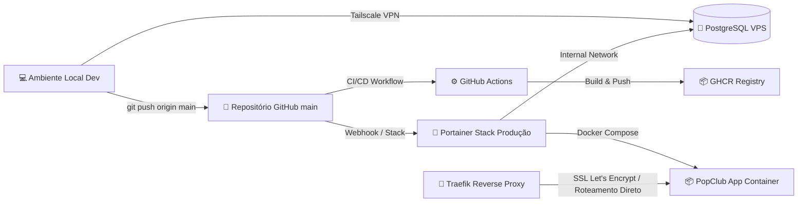

# Diretrizes Operacionais e Governança GitOps

**PopClub — Plataforma de Delivery PWA e Gestão Operacional**

Este documento estabelece o protocolo de governança, arquitetura e entrega contínua (CI/CD) adotado na infraestrutura de produção.

---

## 🏛️ Pilares da Arquitetura



---

## 📜 Regras Mandatórias de Operação

### 1. Single Source of Truth (Fonte Única da Verdade)
- O repositório Git oficial na branch **`main`** é a única fonte de verdade de todo o código, configurações e definições de banco de dados.
- **Proibição de Acesso Manual não Rastreado:** Nenhuma modificação de código, arquivos estáticos ou schema deve ser realizada diretamente em containers em execução (`docker exec`).
- Toda alteração de infraestrutura deve ser registrada declarativamente em `docker-compose.yml` e/ou `popshake-stack.yml`.

### 2. Paridade de Ambiente
- O ambiente de desenvolvimento local pode rodar isolado via `docker-compose.dev.yml` ou conectar-se à instância PostgreSQL na VPS por meio da rede privada **Tailscale** (`<TAILSCALE_IP>:5432`).
- Isso garante paridade de consultas, tipos e constraints entre desenvolvimento e produção.

### 3. Protocolo de Validação Pré-Push (Quality Gate Local Obrigatório)
Antes de qualquer envio para o repositório remoto, o desenvolvedor deve executar:
1. **Geração de Cliente Prisma (se houver alteração no schema):**
   ```bash
   npx prisma generate
   ```
2. **Suíte de Testes Automatizados (Vitest — 54 arquivos / 363 testes):**
   ```bash
   npm test
   ```
3. **Análise Estática (ESLint):**
   ```bash
   npm run lint
   ```
4. **Compilação e Verificação de Tipos (Next.js Standalone):**
   ```bash
   npm run build
   ```
   *Todos os comandos devem finalizar com Exit Code 0.*

### 4. Implantação Declarativa (CI/CD + Portainer)
- Assim que o commit é enviado para a branch `main`:
  1. O **GitHub Actions** (`.github/workflows/deploy.yml`) executa `npm test` e `npm run lint`, compila a imagem Docker multi-stage (`node:20-bookworm-slim` em modo standalone) e publica no **GHCR**.
  2. O **Portainer** gerencia a stack em produção (`docker-compose.yml` / `popshake-stack.yml`), injetando segredos exclusivamente via Environment Variables da stack.
  3. O script `entrypoint.sh` aguarda a prontidão do PostgreSQL, executa `prisma migrate deploy` (quando `prisma/migrations` existir) ou aplica sincronização segura via `prisma db push` (com bloqueio automático de instruções destrutivas `DROP TABLE`, `DROP COLUMN` e `TRUNCATE`) antes de iniciar `node server.js`.
  4. O **Traefik** aplica os roteadores SSL automáticos (`leresolver`) diretamente para o container da aplicação.

---

## 🗂️ Estrutura de Scripts Operacionais

Consulte [scripts/README.md](../scripts/README.md) para detalhes de execução dos testes e utilitários:
- **`scripts/smoke-test-all.mjs`**: Teste de ponta a ponta de autenticação, vitrine, pedidos e cupons.
- **`scripts/diagnose-db.mjs`**: Diagnóstico de latência e contagem de integridade de tabelas.
- **`scripts/utils/reset-admin.mjs`**: Utilitário de segurança para redefinição de credenciais do Administrador.
- **`scripts/utils/transfer-db.mjs`**: Utilitário de extração e migração de dados relacionais via Prisma.
